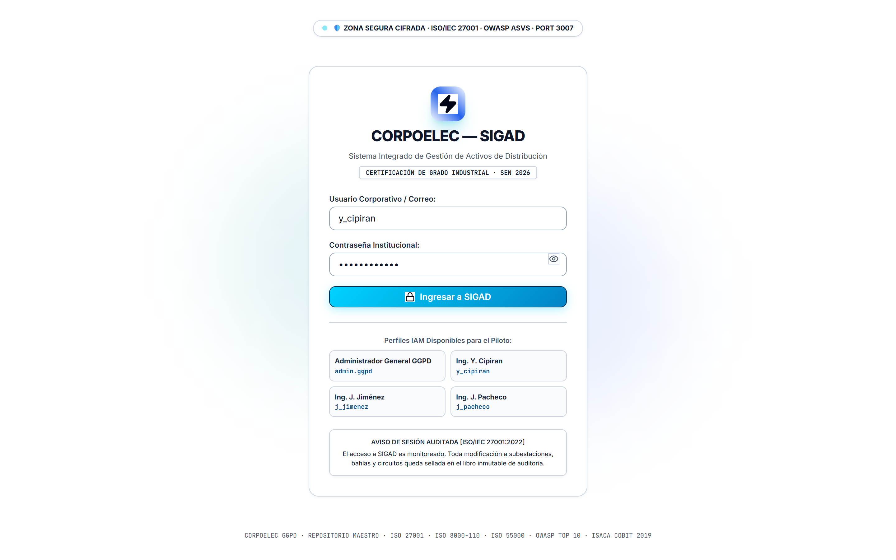
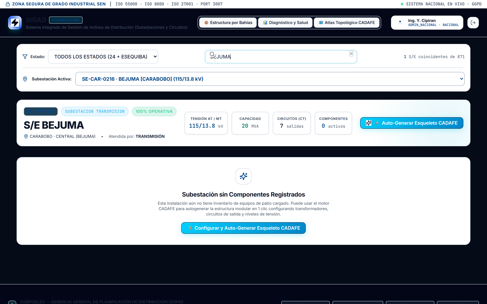
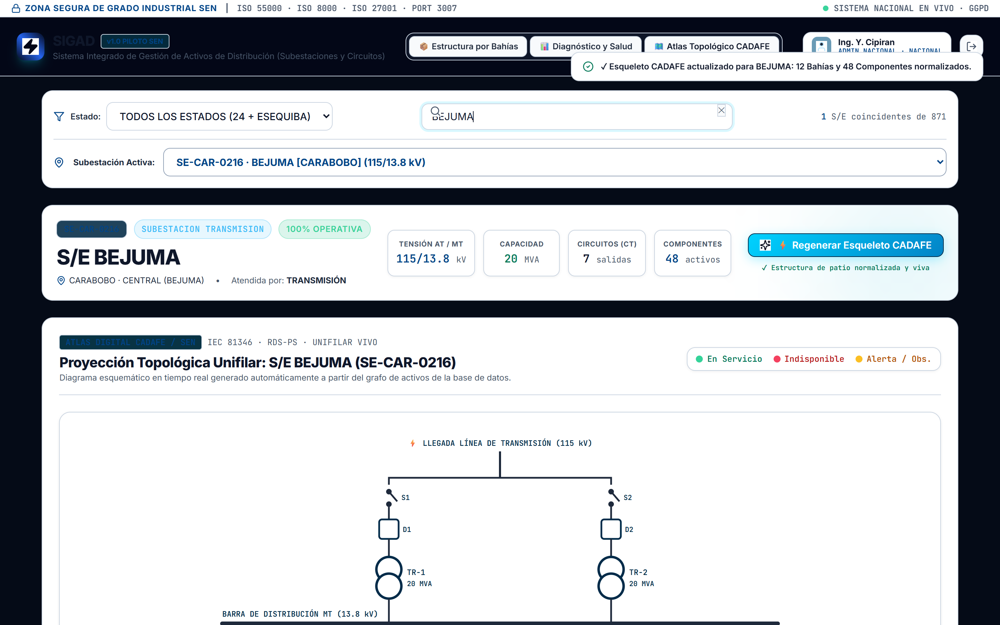
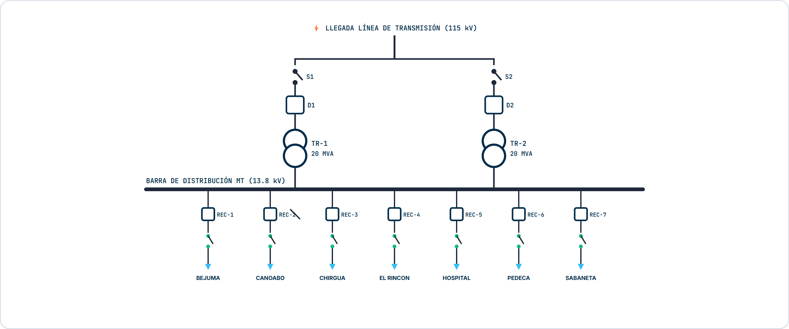
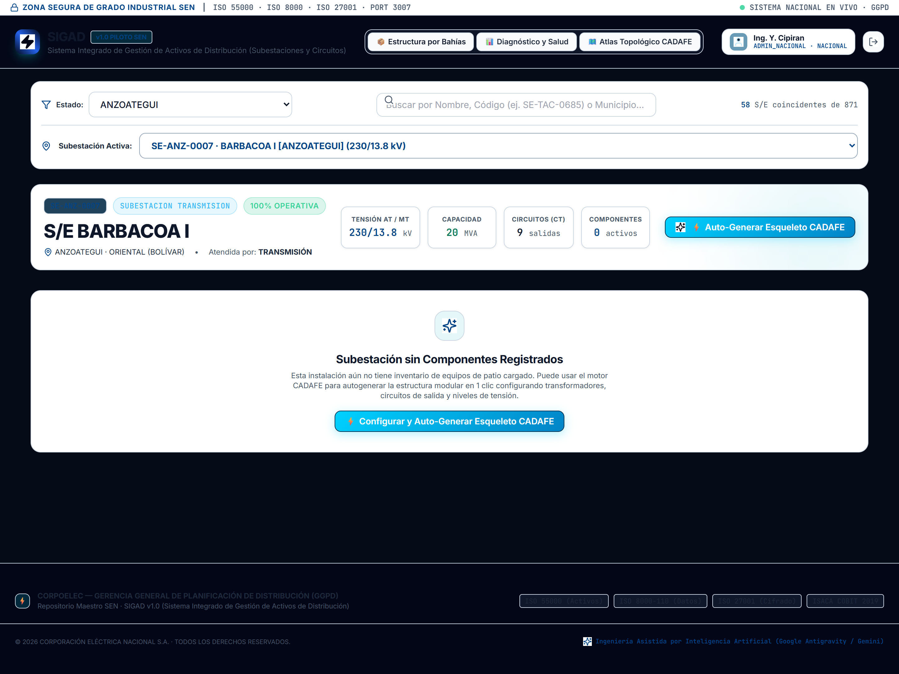
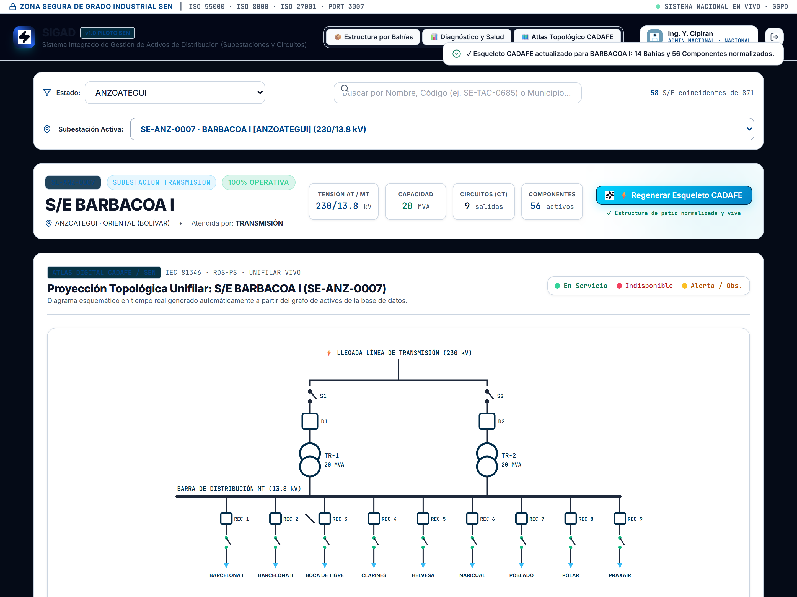
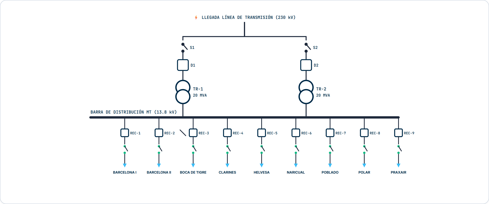

# REPÚBLICA BOLIVARIANA DE VENEZUELA
# MINISTERIO DEL PODER POPULAR PARA LA ENERGÍA ELÉCTRICA (MPPEE)
# CORPORACIÓN ELÉCTRICA NACIONAL, S.A. (CORPOELEC)
## GERENCIA GENERAL DE PLANIFICACIÓN DE DISTRIBUCIÓN (GGPD)

---

```text
====================================================================================================
INSTRUCTIVO OPERATIVO ESTANDARIZADO DE GESTIÓN Y CARGA DE ACTIVOS DE SUBESTACIONES (SIGAD v1.0)
====================================================================================================
CÓDIGO INSTITUCIONAL : GGPD-SGM-INS-007 (v1.0 ISO)
NOMENCLATURA ARCHIVO : NAC_2026_GGPD_INS_OPERATIVO_SIGAD_V01.md
CÓDIGO DOCUMENTAL    : DOC-GGPD-2026-INS-SIGAD-001
APLICACIÓN ASOCIADA  : SIGAD v1.0 (Sistema Integrado de Gestión de Activos de Distribución - Puerto 3007)
AUTOR / ELABORACIÓN  : Equipo de Automatización, Analítica de Datos e Inteligencia Artificial (GGPD)
EN COLABORACIÓN CON  : Especialistas de Operaciones y Mantenimiento de Subestaciones y Líneas SEN
DIRIGIDO A           : Ingenieros de Subestaciones, Planificadores Estadales y Personal Técnico de Distribución
MARCO NORMATIVO      : ISO 55000/55001 (Activos) · ISO 8000-110 (Calidad de Datos) · ISO 9001:2015 (SGC)
                       ISO/IEC 27001:2022 (Seguridad) · ISACA COBIT 2019 · CADAFE NS-P-105 · IEEE 1366 · IEEE 80
FECHA DE EMISIÓN     : Octubre de 2026
ESTADO DE APLICACIÓN : Vigente · Instrumento Técnico de Obligatorio Cumplimiento Nacional
====================================================================================================
```

---

## 📋 1. IDENTIFICACIÓN Y CONTROL DEL DOCUMENTO

| Parámetro Institucional | Especificación Técnica y Normativa |
| :--- | :--- |
| **Organización Emisora:** | Corporación Eléctrica Nacional, S.A. (CORPOELEC) |
| **Órgano Rector / Adscripción:** | Ministerio del Poder Popular para la Energía Eléctrica (MPPEE) |
| **Gerencia Responsable:** | Gerencia General de Planificación de Distribución (GGPD) |
| **Título del Instrumento:** | **Instructivo Operativo Estandarizado para la Caracterización Topológica, Carga de Activos y Control de Ciclo de Vida en el Sistema SIGAD v1.0** |
| **Naturaleza del Documento:** | **Instructivo Técnico Operativo (ITO) / Procedimiento Operativo Estandarizado (POE)**. Conforme a las directrices de la GGPD y la Cláusula 7.5 de la norma ISO 9001:2015 (*Control de la Información Documentada*), este documento reviste carácter de mandato técnico vinculante. **Se excluye taxativamente la figura de "Manual"** debido a la suspensión operativa temporal de la Unidad Central de Registro y Codificación de Manuales de la Corporación, garantizando validez jurídica interna inmediata sin incurrir en vicios de procedimiento corporativo. |
| **Código Nomenclatura Oficial:** | `NAC_2026_GGPD_INS_OPERATIVO_SIGAD_V01` (Base de Codificación: `GGPD-SGM-INS-007 v1.0 ISO`) |
| **Fecha de Aprobación:** | 07 de Octubre de 2026 |
| **Próxima Revisión Ordinaria:** | 07 de Octubre de 2027 |
| **Aprobado y Autorizado por:** | Gerencia General de Planificación de Distribución (GGPD) |

---

## 🎯 2. OBJETIVO (PROPÓSITO)

El presente instructivo establece las pautas técnicas, criterios de ingeniería eléctrica, directrices pedagógicas y mecanismos de control de calidad bajo normas **ISO 55000/55001** e **ISO 8000-110** para la operación, carga de información y diagnóstico de activos de subestaciones y circuitos en el **Sistema Integrado de Gestión de Activos de Distribución (SIGAD v1.0)**.

El propósito central es dotar a CORPOELEC de una **fuente única de verdad (Single Source of Truth)** sobre los 871 nodos de transformación y los 4.207 circuitos del Sistema Eléctrico Nacional (SEN), erradicando el uso de hojas de cálculo dispersas ("sábanas Excel"), cerrando el desfase histórico de seriales de transformadores de potencia quemados frente a equipos repuestos, y permitiendo la visualización de la topología de patio a través del **Atlas Topológico SEN** en tiempo real.

---

## 🌐 3. ALCANCE Y ÁMBITO DE APLICACIÓN

* **A quiénes aplica:** De obligatorio acatamiento para el personal adscrito a las Salas Técnicas y Situacionales de las 24 Entidades Federales y la Guayana Esequiba:
  1. Ingenieros Especialistas en Mantenimiento y Operaciones de Subestaciones de Distribución y Transmisión.
  2. Coordinadores y Analistas Estadales de Planificación de Distribución.
  3. Personal técnico de operaciones, analistas de salas técnicas estadales y personal operativo del área de Distribución.
* **Dónde aplica:** En todas las operaciones realizadas dentro del portal **SIGAD v1.0** (puerto corporativo `3007`, accesible de modo local o a través de la infraestructura cloud autorizada), así como en los procesos de ingesta y sincronización con el almacén de datos maestro PostgreSQL (`ggpd-data-maestra-0002`).
* **Qué procesos abarca:** 
  - Levantamiento y confirmación del árbol topológico por bahías (Bahías AT, Barras MT, Circuitos Alimentadores, Servicios Auxiliares SSAA, Malla de Puesta a Tierra e Infraestructura).
  - Auto-Generación del esqueleto modular bajo norma CADAFE NS-P-105.
  - Registro de placa de equipos (Transformadores de Potencia, Disyuntores, Seccionadores, TC/TP, Reconectadores).
  - Declaración y trazabilidad de eventos de falla, indisponibilidad y reposición de activos en campo.

---

## ⚖️ 4. MARCO NORMATIVO Y REFERENCIAS TÉCNICAS

El presente instructivo se encuentra armonizado con las siguientes regulaciones internacionales e institucionales:

1. **ISO 55000 / ISO 55001:2014 (Gestión de Activos Físicos):** Directrices para el control del ciclo de vida, trazabilidad, criticidad y costo-riesgo de los activos industriales de potencia.
2. **ISO 8000-110 / ISO 8000-115 (Calidad de Datos Maestros):** Rigor sintáctico, completitud, tipado estricto y preservación de identificadores inmutables para prevenir la contaminación de catálogos maestros (MDM).
3. **ISO 9001:2015 (SGC - Cláusula 7.5):** Soporte técnico-administrativo para la emisión y vigencia de Instructivos de Trabajo como información documentada formal.
4. **ISO/IEC 27001:2022 (Seguridad de la Información):** Autenticación perimetral basada en roles (RBAC), confidencialidad de inventarios estratégicos de la República y trazabilidad inmutable de auditoría.
5. **ISACA COBIT 2019 (MEA02 / DSS06):** Supervisión de controles internos, principio de segregación de funciones (*Maker-Checker*) y salvaguarda de transacciones operativas.
6. **CADAFE NS-P-105 (Norma de Proyecto de Subestaciones de Distribución):** Nomenclatura estandarizada de aparamenta, bahías de llegada, esquemas de transformación, barras colectoras y salidas de alimentadores.
7. **IEEE 1366 / IEEE C37 / IEEE 80:** Estándares para confiabilidad de distribución (índices SAIDI/SAIFI/NDI), especificación de interruptores de potencia y diseño de mallas de puesta a tierra.

---

## 📖 5. GLOSARIO DE TÉRMINOS Y DEFINICIONES

* **Bahía (Bay):** Sección delimitada del patio de la subestación que agrupa los equipos de maniobra, corte, transformación y protección asociados a una función eléctrica específica (ej. Bahía de Transformación AT, Bahía de Alimentador MT).
* **Disyuntor / Interruptor de Potencia (D):** Equipo electromecánico capaz de abrir o cerrar un circuito en condiciones normales de carga y extinguir corrientes de cortocircuito (utilizando hexafluoruro de azufre SF6, cámaras de vacío o aceite).
* **Seccionador (S):** Dispositivo mecánico de maniobra que proporciona una distancia de aislamiento visible y segura en aire; no tiene capacidad de apertura bajo corriente de cortocircuito.
* **Transformador de Potencia (TR):** Máquina eléctrica estática que transfiere energía entre niveles de tensión (ej. 115 kV a 13.8 kV) mediante inducción electromagnética.
* **Atlas Topológico SEN:** Módulo de proyección esquemática unifilar generado automáticamente en tiempo real por SIGAD a partir del grafo de activos en la base de datos, sustituyendo el dibujo estático en planos de AutoCAD.
* **Esqueleto Modular CADAFE:** Patrón topológico predeterminado basado en la ingeniería típica de subestaciones venezolanas que inserta con un solo clic los equipos base de una instalación para evitar digitación manual repetitiva.
* **SSAA (Servicios Auxiliares):** Subsistema eléctrico interno de la subestación compuesto por banco de baterías de corriente continua (125 Vcc o 48 Vcc), cargadores-rectificadores y tableros de alterna (208/120 Vac) para la alimentación de relés de protección y mandos de disparo.

---

## ⚡ 6. DESCRIPCIÓN OPERATIVA DEL SISTEMA POR MÓDULOS

A continuación se detalla el funcionamiento de cada módulo de SIGAD v1.0. Para garantizar la asimilación transversal del sistema, cada sección se compone de:
1. **Especificación Técnica de Ingeniería de Subestaciones:** Para ingenieros electricistas y jefes de patio.
2. **Explicación Pedagógica Funcional:** Para analistas de operaciones y coordinadores de sala técnica.
3. **Guía Práctica de Carga para Personal Técnico de Distribución:** Para los analistas y operadores de distribución que alimentan la data en las salas técnicas estadales.

---

### MÓDULO 1: ACCESO Y ZONA SEGURA DE GRADO INDUSTRIAL SEN



#### 🔬 1.1. Para el Ingeniero Especialista en Subestaciones:
El módulo de acceso implementa un perímetro de seguridad criptográfico auditado bajo **ISO/IEC 27001:2022** y **OWASP ASVS Level 2**. Los perfiles de acceso segregan los permisos de mutación topológica: el perfil `ADMIN_NACIONAL` y los especialistas zonales poseen privilegios para alterar parámetros de placa, registrar capacidades nominales en MVA, declarar anomalías en presiones manométricas de SF6 y vincular bahías. Toda sesión autenticada vincula las transacciones de modificación al identificador único del funcionario para fines de responsabilidad civil y técnica en el SEN.

#### 💡 1.2. Explicación Coloquial y Pedagógica:
* **¿Qué hace esta pantalla?** Es la puerta de seguridad de la aplicación.
* **¿Qué solicita?** Tu usuario institucional (por ejemplo: `y_cipiran` o `admin.ggpd`) y tu clave corporativa.
* **¿Cómo se usa?** Escribe tus datos o selecciona uno de los perfiles rápidos de prueba. Si tienes dudas de tu clave, presiona el icono del ojo para ver lo que escribes. Luego presiona el botón azul **"Acceder al Sistema SIGAD"**.

#### 🛠️ 1.3. Guía Práctica de Carga para Personal Técnico de Distribución:
> **Punto clave:** Ingresa con tu credencial formal asignada a tu sala técnica estadal. El sistema muestra arriba el aviso de *Zona Segura Cifrada*. Tras 3 intentos fallidos de contraseña se activa el bloqueo de seguridad. Mantén tu credencial activa y no compartas usuarios entre operadores para asegurar la trazabilidad del trabajo de cada sala técnica.

---

### MÓDULO 2: SELECTOR GEOGRÁFICO Y PANEL DE NAVEGACIÓN


#### 🔬 2.1. Para el Ingeniero Especialista en Subestaciones:
El selector territorial indexa la totalidad de los 871 centros de transformación de distribución y transmisión registrados en `core.mae_subestaciones`. Incorpora filtros determinísticos por las 25 entidades federales (incluyendo la Guayana Esequiba) y resolución heurística por código de instalación normalizado (ej. `SE-CAR-0216` para Bejuma, `SE-TAC-0685` para Agua Dulce, `SE-ANZ-0007` para Barbacoa I). El motor de búsqueda cruza automáticamente el nivel de tensión primario (kV), la pertenencia al macro-proceso y el estado de atención física de la instalación (atendida vs. desatendida/telemandada).

#### 💡 2.2. Explicación Coloquial y Pedagógica:
* **¿Qué hace esta pantalla?** Es tu mapa de navegación. Te permite elegir en qué estado del país vas a trabajar y qué subestación vas a revisar o actualizar.
* **¿Cómo se usa?** 
  1. En el desplegable de la izquierda, elige tu estado (por ejemplo, `CARABOBO` o `ANZOATEGUI`).
  2. En la casilla de texto de la derecha ("Buscar por Nombre, Código..."), escribe las primeras letras del nombre de la subestación.
  3. Haz clic sobre la tarjeta de la subestación que aparezca en la lista para abrir su ficha completa.

#### 🛠️ 2.3. Guía Práctica de Carga para Personal Técnico de Distribución:
> **Punto clave:** Cada instalación tiene un código alfanumérico inmutable (ejemplo: `SE-CAR-0216` para Bejuma en Carabobo). En el área de Distribución muchas veces las cuadrillas llaman a las subestaciones por nombres locales antiguos o de sectores vecinos. **Busca siempre por el CÓDIGO oficial** para no confundir instalaciones homónimas o derivaciones de circuito con la subestación cabecera.

---

### MÓDULO 3: FICHA TÉCNICA 360° Y PANEL DE DIAGNÓSTICO KPI



#### 🔬 3.1. Para el Ingeniero Especialista en Subestaciones:
La Ficha Técnica 360° consolida la relación de transformación nominal de la subestación (ej. 115/13.8 kV, 115/34.5 kV o 34.5/13.8 kV), la capacidad firme y total instalada en MVA, la cantidad de alimentadores de salida y el área de patio en metros cuadrados. El panel inferior evalúa en tiempo real los Indicadores Clave de Salud de Activos (AHI) según **ISO 55000**:

```text
Disponibilidad de Planta (%) = (Componentes en Servicio / Total Componentes Registrados) * 100
```

Categoriza en tiempo real los activos en cuatro cuadrantes de indisponibilidad operativa: *En Servicio*, *Indisponible / Fallado*, *En Observación* y *No Instalado / Proyectado*.

#### 💡 3.2. Explicación Coloquial y Pedagógica:
* **¿Qué hace este panel?** Es el "tablero de control médico" de la subestación. Te dice cuánta potencia tiene, cuántas salidas hacia las comunidades posee y si sus equipos están sanos o enfermos.
* **¿Qué significan las tarjetas de colores?**
  - 🟢 **Verde (En Servicio):** Equipos funcionando perfectamente con electricidad.
  - 🔴 **Rojo (Indisponible / Averiado):** Equipos dañados, quemados o fuera de combate.
  - 🟡 **Amarillo (En Observación):** Equipos con algún detalle menor (fuga leve de aceite, calentamiento, etc.) que están trabajando bajo vigilancia.
  - ⚪ **Gris (No Instalado):** Espacios donde debería haber un equipo pero actualmente está el hueco vacío en el patio.

#### 🛠️ 3.3. Guía Práctica de Carga para Personal Técnico de Distribución:
> **Punto clave:** Presta especial atención a la unidad de potencia: **MVA** (Megavoltio-Amperio). En redes de distribución se manejan transformadores aéreos en kVA (ej. 25 kVA, 50 kVA, 100 kVA), pero en subestaciones las potencias se expresan en MVA (ej. 10 MVA, 16 MVA, 20 MVA, 36 MVA). Si en la ficha de campo del transformador de potencia lees `16.000 kVA`, en SIGAD debes colocar **16.0 MVA** (dividiendo entre 1.000), de modo que los balances de carga nacional no se alteren.

---

### MÓDULO 4: GENERACIÓN ASISTIDA DEL ESQUELETO CADAFE NS-P-105


#### 🔬 4.1. Para el Ingeniero Especialista en Subestaciones:
Para erradicar la barrera de carga manual de 60 a 90 componentes por patio, SIGAD incorpora un autómata topológico regido por la norma venezolana **CADAFE NS-P-105**. Al activar la auto-generación, el motor sintetiza:
1. Bahías de Transformación AT con su disyuntor principal (código D1/D2), seccionadores de aislamiento y puesta a tierra (S1, S2, ST), descargadores de sobretensión ZnO y transformadores de corriente de protección diferencial 87T.
2. Bahía de Barras Colectoras MT con seccionador de transferencia y medición TP de barra.
3. Bahías de Salida de Alimentadores alimentadas directamente desde la base canónica de **4.207 Circuitos Reales** de `core.mae_circuitos`. El modal interactivo presenta al especialista los circuitos mapeados (ej. en S/E BEJUMA: *Bejuma, Canoabo, Chirgua, El Rincón, Hospital, Pedeca* a 13.8 kV y *Sabaneta* a 34.5 kV) para activar, desactivar o agregar salidas emergentes antes del compromiso transaccional.
4. Servicios Auxiliares (Transformador SSAA, banco de acumuladores Plomo-Ácido/Níquel-Cadmio 125 Vcc y rectificador industrial).

#### 💡 4.2. Explicación Coloquial y Pedagógica:
* **¿Qué hace este botón milagroso?** En lugar de que tengas que escribir uno por uno 80 equipos en blanco, este botón crea la estructura base típica de la subestación en un segundo.
* **¿Cómo se usa?** 
  1. Presiona el botón que dice **"Auto-Generar / Regenerar Esqueleto CADAFE"**.
  2. Se abrirá una ventana con la lista de los circuitos que legalmente alimentan a esa zona.
  3. Revisa la lista: desmarca los circuitos que físicamente ya no existan en el patio y añade si hay alguno nuevo.
  4. Presiona el botón verde **"Confirmar y Generar Estructura CADAFE"**. ¡Listo! El patio se poblará automáticamente.

#### 🛠️ 4.3. Guía Práctica de Carga para Personal Técnico de Distribución:
> **Punto clave:** Esta función automatiza el 90% del trabajo de carga en las salas estadales. Como técnico de distribución, tu labor aquí es de **cotejo**: revisa la lista de circuitos que muestra el modal frente al esquema operativo vigente de tu estado. Si un circuito fue transferido a otra subestación o está fuera de servicio definitivo, desmárcalo en el checklist antes de confirmar.

---

### MÓDULO 5: GESTIÓN JERÁRQUICA DEL ÁRBOL DE BAHÍAS Y EQUIPOS


#### 🔬 5.1. Para el Ingeniero Especialista en Subestaciones:
El módulo de árbol organiza los activos bajo una estricta jerarquía ANSI/IEEE e ISO 55000:
`Subestación ➔ Bahía (Bay) ➔ Componente Primario / Secundario ➔ Eventos de Ciclo de Vida`

Permite editar en caliente la ficha técnica de cada equipo: TAG operativo normalizado (`TR-1`, `D1`, `S1-1`, `REC-BEJ`), número de serial troquelado de placa, fabricante (ej. Westinghouse, General Electric, EFACEC, Siemens, ABB, Pauwels), año de puesta en servicio, presión de gas SF6 en bar (con umbral de disparo por baja presión típicamente a < 4.5 bar), nivel de aceite dieléctrico en cuba y conservación mediante tanque de expansión y sílica gel.

#### 💡 5.2. Explicación Coloquial y Pedagógica:
* **¿Qué es esta vista?** Es como una carpeta de archivos de tu computadora. Cada "carpeta" es una Bahía (un pedazo del patio de la subestación) y adentro están los equipos que viven allí.
* **¿Qué puedes hacer aquí?**
  - Puedes hacer clic en una bahía para abrirla y ver sus equipos.
  - Al lado de cada equipo hay botones para: **Editar sus datos** (icono de lápiz), **Declarar que se rompió** (icono de rayo rojo) o **Marcar que lo arreglaron** (icono de check verde).
  - Si falta una bahía o un equipo que el autómata no creó, puedes agregarlo con los botones de **"+ Agregar Bahía"** o **"+ Agregar Equipo"**.

#### 🛠️ 5.3. Guía Práctica de Carga para Personal Técnico de Distribución:
> **Punto clave:** Cada bahía agrupa los equipos según su función en patio. En la Bahía de Transformación encontrarás el transformador de potencia principal y sus interruptores asociados; en las Bahías de Circuito encontrarás los reconectadores o interruptores que alimentan las redes aéreas o subterráneas del municipio. Abre cada equipo con el botón de edición y carga los datos reales verificados en los informes de mantenimiento.

---

### MÓDULO 6: ATLAS TOPOLÓGICO SEN (VISOR UNIFILAR EN TIEMPO REAL)





#### 🔬 6.1. Para el Ingeniero Especialista en Subestaciones:
El Atlas Topológico SEN constituye un motor de renderizado vectorial SVG interactivo que computa la topología de nodos y ramas en tiempo de ejecución. Deriva dinámicamente el diagrama unifilar eléctrico a partir de la conectividad de los componentes: barraje de entrada de alta tensión (115 kV), seccionadores de aislamiento (S1, S2), disyuntores de potencia principales (D1, D2), transformadores de potencia (TR-1 y TR-2 de 20 MVA, relación 115/13.8 kV), barra colectora de media tensión con su barra rígida a 13.8 kV, y las salidas radiales protegidas por reconectadores de circuito (REC-1 a REC-7). Los componentes reflejan en tiempo real su estado operativo mediante codificación de color ANSI (Rojo = Averiado/Abierto, Verde = En Servicio/Cerrado).

#### 📐 6.2. Desglose de Ingeniería del Diagrama Unifilar (S/E BEJUMA):
El diagrama unifilar vectorial SVG proyectado en pantalla refleja con exactitud la configuración de patio de S/E BEJUMA (`SE-CAR-0216`):
1. **Llegada de Transmisión (115 kV):** Acometida aérea de alta tensión troncal dividida hacia dos campos de transformación.
2. **Aparamenta de Alta Tensión:** Seccionadores tripolares de maniobra S1 y S2 en serie con disyuntores de potencia D1 y D2 (cámaras SF6 / vacío).
3. **Bancos de Transformación:** Dos máquinas de potencia principales identificadas como TR-1 (20 MVA) y TR-2 (20 MVA), con grupo de conexión Dyn11 y refrigeración ONAN/ONAF.
4. **Barra Colectora de Distribución MT (13.8 kV):** Barraje principal de media tensión que interconecta ambos transformadores y alimenta los alimentadores de distribución.
5. **Bahías de Salida de Alimentadores (Reconectadores de Distribución):**
   - **REC-1:** Circuito BEJUMA (Alimentador principal casco central y comercial, 13.8 kV).
   - **REC-2:** Circuito CANOABO (Alimentador agrícola / turístico, 13.8 kV).
   - **REC-3:** Circuito CHIRGUA (Valle agropecuario / bombeo de agua, 13.8 kV).
   - **REC-4:** Circuito EL RINCÓN (Cargas residenciales y suburbanas, 13.8 kV).
   - **REC-5:** Circuito HOSPITAL (Circuito priorizado de seguridad social y salud, 13.8 kV).
   - **REC-6:** Circuito PEDECA (Zona industrial / producción de agregados, 13.8 kV).
   - **REC-7:** Circuito SABANETA (Circuito mixto interconectado, 13.8/34.5 kV).

#### 💡 6.3. Explicación Coloquial y Pedagógica:
* **¿Qué es el Atlas Topológico?** Es el plano eléctrico de la subestación dibujado por la computadora de manera automática.
* **¿Para qué sirve?** Te permite ver en una sola mirada cómo viaja la electricidad desde que entra por las torres de alta tensión hasta que sale por los circuitos hacia la calle. Si un transformador o un interruptor se daña, en este dibujo se pondrá rojo inmediatamente, permitiendo que cualquier persona entienda qué parte de la subestación está sin luz sin necesidad de saber dibujar planos en programas complicados.

#### 🛠️ 6.4. Guía Práctica de Carga para Personal Técnico de Distribución:
> **Punto clave:** El Atlas Topológico es tu herramienta de verificación inmediata. No requiere que muevas líneas ni configures software CAD. Cada vez que confirmas o ajustas un equipo en el Árbol de Bahías, el diagrama se redibuja solo. Si una subestación tiene 7 alimentadores en servicio, debes ver reflejadas con exactitud las 7 salidas en el barraje de media tensión con los nombres reales de los pueblos y circuitos que atienden.

---

### MÓDULO 7: SEGUNDA SUBESTACIÓN — CASO DE ESTUDIO: S/E BARBACOA I (ANZOÁTEGUI)

Para demostrar la robustez multi-estatal y la escalabilidad del sistema, se presenta a continuación la caracterización operativa de una segunda instalación en el oriente del país: **S/E BARBACOA I (`SE-ANZ-0007`)**, ubicada en el estado Anzoátegui, nodo neurálgico de alta potencia con múltiples salidas a 13.8 kV.







#### 🔬 7.1. Análisis Técnico Comparativo (Bejuma vs. Barbacoa I):
* **S/E BEJUMA (`SE-CAR-0216`, Carabobo):** Tipología mixta rural/suburbana alimentada a 115 kV, caracterizada por salidas tanto en 13.8 kV (zona urbana y agropecuaria) como una derivación a 34.5 kV (Circuito Sabaneta).
* **S/E BARBACOA I (`SE-ANZ-0007`, Anzoátegui):** Nodo concentrador de alta densidad de carga urbana/industrial en el eje metropolitano de Anzoátegui, con llegada de Transmisión a **230 kV** y **9 circuitos de distribución oficiales** asociados en `core.mae_circuitos`. Al regenerar su esqueleto CADAFE, el sistema proyecta en su Atlas Topológico un barraje colector extendido que preserva la proporcionalidad espacial en el diagrama vectorial SVG sin solapamiento de bahías ni distorsión gráfica.

#### 📐 7.2. Desglose de Ingeniería del Diagrama Unifilar (S/E BARBACOA I):
El diagrama unifilar SVG de Barbacoa I exhibe la siguiente topología de alta capacidad:
1. **Llegada de Transmisión (230 kV):** Interconexión troncal con el sistema de 230/400 kV (subestaciones Barbacoa II y Tigre I).
2. **Bahías de Transformación:** Seccionadores S1 y S2 con disyuntores de potencia D1 y D2 de alta capacidad de ruptura.
3. **Transformadores de Potencia:** TR-1 (20 MVA) y TR-2 (20 MVA) con relación de transformación 230/13.8 kV.
4. **Barraje Colector MT (13.8 kV):** Barra rígida de gran longitud dimensionada para la evacuación de potencia hacia 9 alimentadores.
5. **Nueve (9) Circuitos de Distribución MT (Reconectadores REC-1 a REC-9):**
   - **REC-1:** Circuito BARCELONA I (Troncal urbana sector comercial / residencial Barcelona).
   - **REC-2:** Circuito BARCELONA II (Segundo troncal urbano metropolitano).
   - **REC-3:** Circuito BOCA DE TIGRE (Comunidad suburbana y vialidad troncal).
   - **REC-4:** Circuito CLARINES (Interconexión de distribución y bombeo).
   - **REC-5:** Circuito HELVESA (Zona industrial y manufactura).
   - **REC-6:** Circuito NARICUAL (Sector rural-urbano y servicios comunales).
   - **REC-7:** Circuito POBLADO (Densidad poblacional y centros educativos).
   - **REC-8:** Circuito POLAR (Sector industrial y alimenticio priorizado).
   - **REC-9:** Circuito PRAXAIR (Complejo químico-industrial de gases del aire).

#### 💡 7.3. Explicación Coloquial y Pedagógica:
* **¿Qué demuestra este segundo ejemplo?** Demuestra que el sistema funciona igual de bien tanto en el centro como en el oriente del país, o en cualquier estado de Venezuela. Sin importar si la subestación es pequeña (con 3 salidas) o grande (con 9 salidas como Barbacoa I o 17 como Barcelona), SIGAD adapta la pantalla y el diagrama unifilar automáticamente sin desordenarse.

---

### MÓDULO 8: CICLO DE VIDA, DECLARACIÓN DE FALLA Y RESTABLECIMIENTO (CIERRE CON SCEIN)

#### 🔬 8.1. Para el Ingeniero Especialista en Subestaciones:
El subsistema de eventos de ciclo de vida resuelve definitivamente la discordancia histórica entre las matrices de contingencia de campo y el censo nacional de activos. Al declarar un equipo como `INDISPONIBLE / FALLADO`, SIGAD obliga a tipificar el evento según el catálogo oficial de **22 causas SEN** (sobrecarga, descarga atmosférica, cortocircuito externo, falla interna de devanados, disparo de protección diferencial 87T o de sobrecorriente 50/51, falla dieléctrica de aceite, fuga de gas SF6, pérdida de servicios auxiliares DC, entre otras). 

Al ejecutar el restablecimiento a servicio, el modal exige clasificar la acción operativa:
1. **Reparación in situ:** El equipo original fue intervenido y rehabilitado manteniendo su TAG, marca, modelo y serial de placa.
2. **Reemplazo por Activo Nuevo o Repuesto:** El equipo averiado fue desincorporado y se instaló una unidad sustituta. En este caso, el sistema exige ingresar de forma obligatoria el **nuevo número de serial**, la **nueva capacidad nominal en MVA** y el **año de fabricación**, actualizando el nodo de activos de `core` y cerrando la trazabilidad con el sistema de equipos indisponibles (SCEIN).

#### 💡 8.2. Explicación Coloquial y Pedagógica:
* **¿Por qué este paso es tan importante?** Porque cuando un transformador se quema y meses después CORPOELEC coloca otro transformador nuevo traído de otro almacén, en los papeles viejos se solía olvidar cambiar el número de serial. Luego ocurría otra falla y nadie sabía qué transformador estaba puesto allí en la realidad.
* **¿Cómo se hace?**
  - Si el equipo se dañó: presiona el rayito rojo, elige la causa (por ejemplo: "Cortocircuito" o "Fuga de Aceite") y escribe una breve nota de lo que pasó.
  - Cuando lo cambien por uno nuevo: presiona el botón de restablecer, marca la opción "Reemplazo por equipo nuevo" y escribe con cuidado el nuevo serial y la nueva capacidad de potencia que vienen troquelados en la placa de metal.

---

## 🧐 7. ANÁLISIS CRÍTICO DE GOBERNANZA: SUPERVISIÓN ESTADAL Y SEGREGACIÓN DE ROLES EN DISTRIBUCIÓN

A continuación se expone la evaluación técnica y de gobernanza de datos bajo normas **ISO 8000-110**, **ISO 55000** e **ISACA COBIT 2019**, enfocada en la dinámica real de las salas técnicas y operativas de Distribución en los 24 estados del país.

---

### 7.1. La Brecha de Especialización: Redes de Distribución vs. Equipos de Potencia de Subestaciones

```text
┌─────────────────────────────────────────────────────────────────────────────────────────────┐
│                   MARCO DE SUPERVISIÓN ESTADAL EN DISTRIBUCIÓN (ISO 8000-110)               │
├─────────────────────────────────────────────────────────────────────────────────────────────┤
│                                                                                             │
│  [NIVEL SALA TÉCNICA ESTADAL]                   [COMPLEJIDAD DE PATIO EN SUBESTACIÓN]       │
│   Operadores y Técnicos de Redes MT/BT           Trafos de Potencia, Disyuntores SF6,       │
│   Dominio de alimentadores y trafos aéreos       Cámaras Vacío, TC/TP, Barras MT y SSAA     │
│                 │                                                   │                       │
│                 └─────────────────────┬─────────────────────────────┘                       │
│                                       ▼                                                     │
│                      ┌─────────────────────────────────┐                                    │
│                      │   ADUANA TÉCNICA SUPERVISADA    │                                    │
│                      │  Coordinador Estadal / S/E      │                                    │
│                      │  Validación Topológica Obligada │                                    │
│                      └────────────────┬────────────────┘                                    │
│                                       ▼                                                     │
│                      ┌─────────────────────────────────┐                                    │
│                      │  BASE DE DATOS MAESTRA NACIONAL │                                    │
│                      │ (core.mae_activos · CERO MOCK)  │                                    │
│                      └─────────────────────────────────┘                                    │
└─────────────────────────────────────────────────────────────────────────────────────────────┘
```

#### 🚨 1. Asimetría de Conocimiento en las Regiones:
* **Diagnóstico:** El personal técnico del área de Distribución en las salas situacionales estadales posee una alta pericia en el manejo de alimentadores, reconectadores de línea, transferencias de carga y transformadores de distribución (13.8 kV / 120-240 V). Sin embargo, los equipos primarios de patio de subestación (transformadores de potencia de 115 kV o 230 kV, interruptores en SF6, sistemas de protección diferencial y bancos de baterías DC de servicios auxiliares) son típicamente atendidos por las gerencias de Mantenimiento de Subestaciones o Transmisión.
* **Impacto:** Si se asigna la carga de la subestación a técnicos de distribución sin una guía visual clara ni supervisión técnica, existe un riesgo recurrente de:
  - Confundir la capacidad de placa anotando kVA en lugar de MVA (multiplicando o dividiendo por 1.000 la potencia nominal).
  - Confundir Transformadores de Corriente (TC) con Transformadores de Potencial (TP).
  - Registrar el serial del conmutador de tomas bajo carga (OLTC) en lugar del serial de la máquina principal.
* **Solución de Gobernanza:** **Supervisión Estadal Obligatoria.** La transcripción de campo es realizada por el personal técnico de la sala de distribución, pero la **aprobación y certificación de los datos de placa** debe ser visada por el Coordinador Estadal de Planificación o el Ingeniero de Subestaciones asignado a la zona.

#### 📉 2. Erradicación del "Agotamiento por Sábana Excel":
* Históricamente, las gerencias exigían a los estados llenar matrices de Excel con más de 80 columnas por equipo. Ante la escasez de personal en regiones como Amazonas, Apure o Delta Amacuro, el resultado inevitable era el **abandono del censo** o la copia masiva de datos idénticos de otras instalaciones.
* El motor de **Auto-Esqueleto CADAFE NS-P-105** de SIGAD resuelve de raíz este problema: el sistema pre-configura la topología típica en 1 clic y cruza los circuitos oficiales de la base de datos nacional, reduciendo la carga del operador regional en más de un 85%.

---

### 7.2. Arquitectura de Gobernanza en Tres (3) Capas Institucionales

```text
┌─────────────────────────────────────────────────────────────────────────────────────────────┐
│                 SUITE MODULAR DE GOBERNANZA OPERATIVA EN TRES (3) CAPAS                     │
├─────────────────────────────────────────────────────────────────────────────────────────────┤
│                                                                                             │
│  [CAPA 1: CRITERIO TÉCNICO NORMATIVO (INGENIEROS ESPECIALISTAS EN SUBESTACIONES)]           │
│  - Documento formal GGPD-SGM-INS-007 v1.0 ISO.                                              │
│  - Parámetros CADAFE NS-P-105, IEEE, ISO 55000, análisis DGA, impedancias Z% y protecciones.│
│  - Destinatarios: Jefes de Subestaciones, Planificadores Estadales y Supervisores de Mantenimiento.│
│                                                                                             │
│  [CAPA 2: GUÍA OPERATIVA PRÁCTICA (PERSONAL TÉCNICO Y ANALISTAS DE DISTRIBUCIÓN)]          │
│  - Flujo guiado de pantalla, diccionario de términos de patio y analogías operativas.       │
│  - Tabla de transcripción rápida de placas de gabinete (campo a campo).                     │
│  - Destinatarios: Analistas de Salas Técnicas Estadales y Operadores de Distribución.       │
│                                                                                             │
│  [CAPA 3: BLINDAJE POR SOFTWARE POKA-YOKE (EN LA PROPIA APLICACIÓN SIGAD)]                  │
│  - Principio Maker-Checker (Doble Aduana / 4-Eyes de COBIT 2019):                           │
│      1. Analista de Distribución registra los datos técnicos verificados en gabinete.       │
│      2. Coordinador Estadal / Especialista de S/E valida la coherencia y certifica el activo.│
│  - Controles de validación automática en inputs (límites de MVA, presiones de SF6,          │
│    catálogo maestro de 4.207 circuitos oficiales).                                          │
└─────────────────────────────────────────────────────────────────────────────────────────────┘
```

---

### 7.3. Principio de Responsabilidad Territorial Indivisible y Tutela Técnica Estadal

Desde la perspectiva rectora de la Gerencia General de Planificación de Distribución (GGPD) y la arquitectura del Repositorio Maestro, **el nivel central se mantiene inquebrantable en la línea de las mejores prácticas internacionales de ingeniería eléctrica y gobernanza de datos (ISO 8000, ISO 55000, ISO 9001 y COBIT 2019)**. La Corporación no relajará los estándares de calidad ni degradará el rigor técnico de sus instrumentos para amparar informalidades o atajos operativos locales.

En consecuencia, se establece de forma categórica el siguiente lineamiento de gobernanza:
* **Autonomía y Responsabilidad Estadal Exclusiva:** Si una Sala Situacional o Coordinación Estadal decide, en virtud de su disponibilidad de recursos, incorporar personal técnico de apoyo, operadores auxiliares o pasantes universitarios para asistir en la transcripción de datos, **dicha decisión y la absoluta responsabilidad jurídica, técnica y operativa sobre los datos que se suban recae única y exclusivamente sobre el Ingeniero Especialista o Coordinador de Distribución en el Estado**.
* **Indivisibilidad de la Responsabilidad y Supervisión Exhaustiva:** La responsabilidad por la información de los activos estratégicos del SEN no es delegable. Ante cualquier inconsistencia detectada en auditorías, balances de carga o adquisiciones de repuestos, **no se admitirá bajo ningún concepto la excusa de fallas atribuibles al personal de apoyo**. Por lo tanto, el ingeniero o especialista estadal está obligado a ejecutar una **supervisión exhaustiva y rigurosa**, asumiendo la tutoría presencial y explicando a profundidad a su equipo el proceso de estructuración topológica, los diagramas unifilares y las normas CADAFE NS-P-105 antes de certificar cualquier registro en el sistema.
* **Supervisión Reforzada y Auditoría de Calidad desde la Gerencia Nacional (GGPD):** En aquellos estados identificados con alta vulnerabilidad operativa, limitaciones de plantilla técnica o donde se conozca la incorporación de personal auxiliar de apoyo, la Gerencia General de Planificación de Distribución activará de oficio una **Supervisión Reforzada**. Este mecanismo contempla auditorías de consistencia sintáctica y semántica bajo norma **ISO 8000-110**, muestreos aleatorios de validación de placas, contraste cruzado contra los históricos de contingencia de SCEIN y verificación del Atlas Topológico, asegurando un acompañamiento técnico de alto nivel que salvaguarde la integridad de la base de datos maestra nacional del SEN.

---

## 👥 8. MATRIZ DE ROLES Y RESPONSABILIDADES (RACI)

Conforme a los estándares **ISACA COBIT 2019** e **ISO 9001**, las responsabilidades operativas en el ciclo de vida de SIGAD se distribuyen según la siguiente matriz:

| Fase Operativa / Tarea | Analista Técnico de Distribución | Especialista de Subestaciones | Coordinador Estadal GGPD | Administrador Nacional de Sistemas e IA |
| :--- | :---: | :---: | :---: | :---: |
| **Cotejo de fotos de placa e informes de mantenimiento** | **R** | **C** | **I** | **I** |
| **Transcripción de datos de placa en SIGAD** | **R** | **C** | **I** | **I** |
| **Activación y Ajuste de Esqueleto CADAFE (Checklist Circuitos)** | **R** | **R** | **A** | **I** |
| **Certificación y Aprobación de Datos de Placa (MVA, kV, Z%)** | **C** | **R** | **A** | **I** |
| **Declaración de Fallas y Fugas de Aceite** | **C** | **R** | **A** | **I** |
| **Restablecimiento y Reemplazo de Equipos (Nuevo Serial/MVA)** | **C** | **R** | **A** | **I** |
| **Monitoreo de Servidor y Calidad de Datos (Puerto 3007)** | **I** | **I** | **C** | **R** / **A** |

*Convención:*
* **R (Responsible):** Personal encargado de la ejecución directa de la tarea.
* **A (Accountable):** Máxima autoridad que aprueba, convalida y asume la responsabilidad administrativa.
* **C (Consulted):** Especialista técnico al que se solicita criterio experto.
* **I (Informed):** Personal clave que es notificado de los avances y cierres del proceso.

---

## ⚠️ 9. GESTIÓN DE INCUMPLIMIENTOS Y CONTROL DE ERRORES

1. **Intento de Registro con Datos Ficticios (Mock Data):** Queda terminantemente prohibido inventar seriales genéricos (como `SERIAL123`, `S/N`, `000000`). El sistema registrará el evento en la traza de auditoría; la reincidencia conllevará el bloqueo temporal de la cuenta del usuario y la emisión de una No Conformidad bajo norma ISO 9001.
2. **Violación de Límites Físicos:** El sistema rechazará de forma instantánea el registro de transformadores de distribución con tensiones o potencias absurdas (ej. > 250 MVA o < 1 kVA), emitiendo una alerta visual en pantalla.
3. **Discrepancia Territorial de Circuitos:** Si un estado intenta asociar un circuito que no pertenece geográficamente a su cabecera sin justificación técnica, el sistema emitirá una observación para revisión del Administrador Nacional.

---

## 🗄️ 10. CONTROL DE REGISTROS, EVIDENCIAS Y TRAZABILIDAD (ISO 27001)

* **Bitácora Inmutable de Auditoría:** Cada mutación en la base de datos de activos (creación de bahía, alteración de equipo, declaración de avería o sustitución) genera un registro inmutable en PostgreSQL que almacena: `usuario_id`, `direccion_ip`, `se_codigo`, `componente_id`, `timestamp_iso` y el detalle exacto de los campos modificados (valor anterior vs. nuevo valor).
* **Custodia y Tiempo de Retención:** Los censos de activos y sus historiales de eventos de falla se conservarán en los almacenes de datos maestros de CORPOELEC por un periodo mínimo ininterrumpido de **diez (10) años**, garantizando la memoria técnica de la infraestructura del SEN.

---

## 📅 11. DISPOSICIONES FINALES, DEROGATORIAS Y VIGENCIA

1. El presente **Instructivo Técnico Operativo entra en vigencia a partir de su emisión en fecha 07 de Octubre de 2026**.
2. Quedan derogadas y sin efecto cualesquiera minutas internas, circulares no estandarizadas o formatos provisionales en hojas de cálculo que contravengan las reglas taxonómicas y topológicas aquí estipuladas.
3. Se instruye a los 24 Coordinadores Estadales de Planificación de Distribución a organizar sesiones técnicas de inducción para la divulgación obligatoria de este documento a todo el personal técnico y de relevo adscrito a sus salas operativas.

---

## 📎 12. ANEXOS: MODELO DE FICHA RÁPIDA DE TRANSCRIPCIÓN DE GABINETE (PARA ANALISTAS TÉCNICOS DE DISTRIBUCIÓN)

A modo de herramienta práctica inmediata, se anexa el formato estándar para que el personal técnico de distribución transcriba los datos de placa sin confusiones sintácticas:

```text
====================================================================================================
GUÍA DE TRANSCRIPCIÓN RÁPIDA DE PLACA: TRANSFORMADORES DE POTENCIA (TR)
====================================================================================================
CAMPO EN SIGAD           ¿DÓNDE MIRAR EN EL INFORME O FOTO DE PLACA?   EJEMPLO VÁLIDO EN PANTALLA
----------------------------------------------------------------------------------------------------
Código TAG               En el unifilar oficial de la subestación      TR-1  (o TR-2)
Fabricante               Marca comercial principal del equipo         PAUWELS / EFACEC / SIEMENS
Número de Serial         Buscar "SERIAL No." o "NÚMERO DE FABRICACIÓN" 94-TR-504218
Año de Fabricación       Buscar "YEAR", "FECHA" o "AÑO"               2008
Capacidad Nominal        Buscar "POTENCIA", "RATED POWER" o "MVA"      16.0  (Si está en kVA, dividir / 1000)
Tensión Primaria         Buscar "HV", "ALTA TENSIÓN" o "PRIMARIO"     115.0  (o 34.5)
Tensión Secundaria       Buscar "LV", "BAJA TENSIÓN" o "SECUNDARIO"   13.8
Nivel de Aceite          Inspección visual del visor de nivel          NORMAL / BAJO
Observaciones            Registros del informe de mantenimiento       "Mantenimiento mayor ejecutado 2025"
====================================================================================================
```

---
*Fin del Documento Institucional — Código Oficial: `NAC_2026_GGPD_INS_OPERATIVO_SIGAD_V01.md` / `GGPD-SGM-INS-007 (v1.0 ISO)`*
