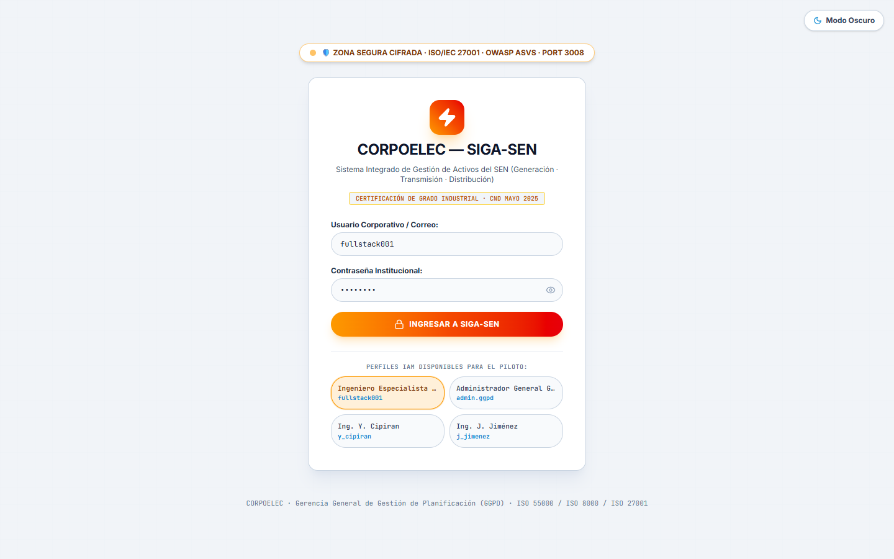
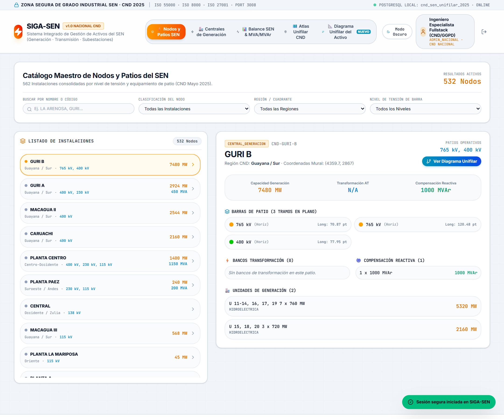
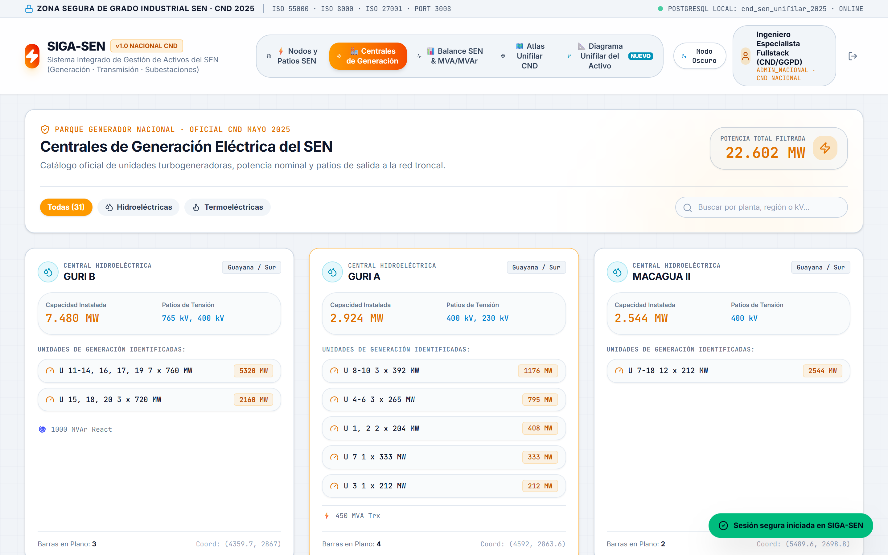
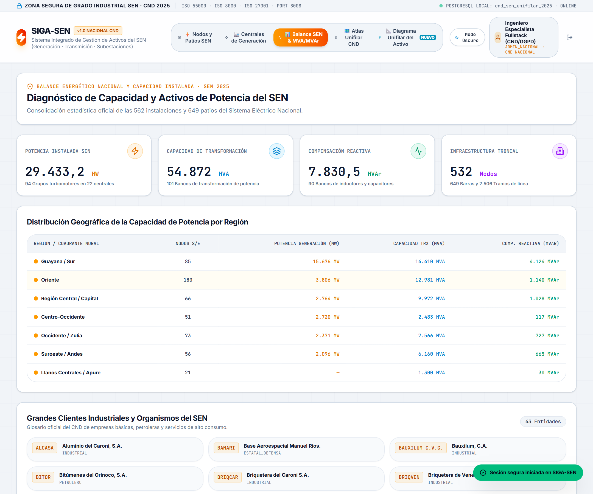
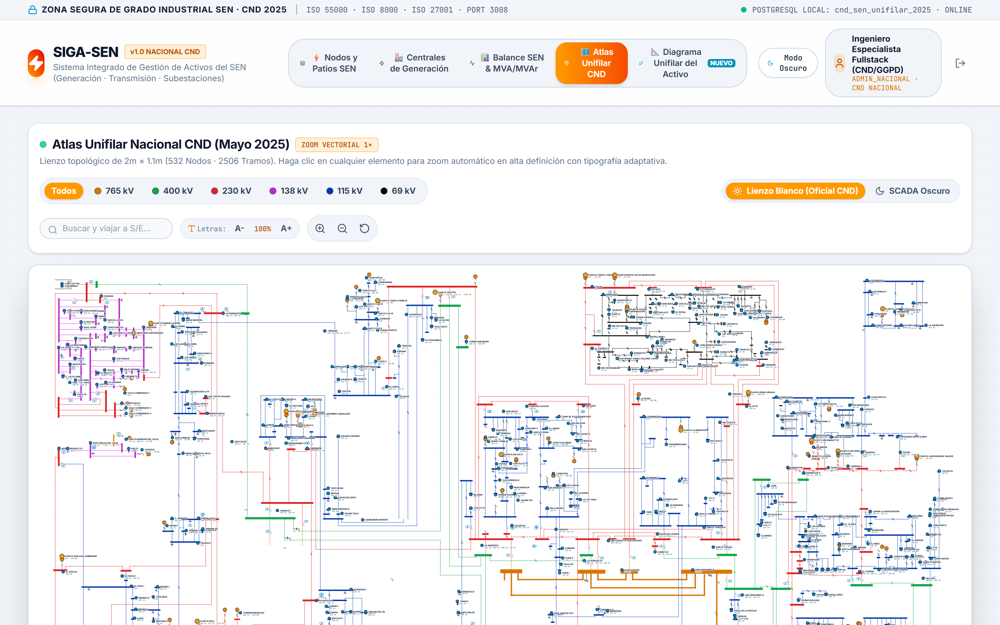
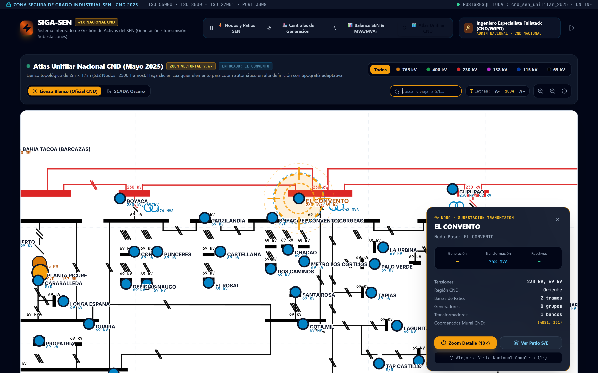
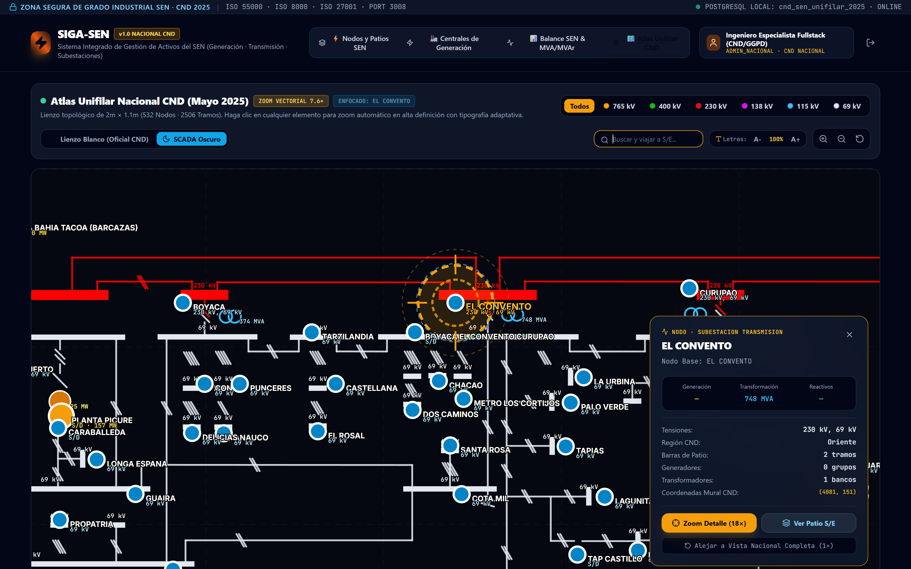
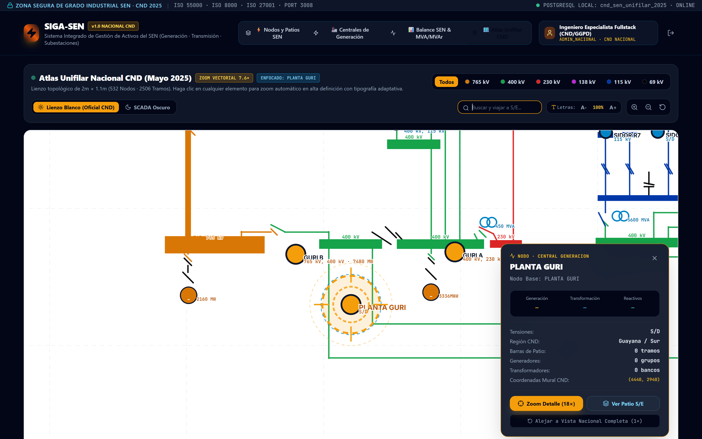
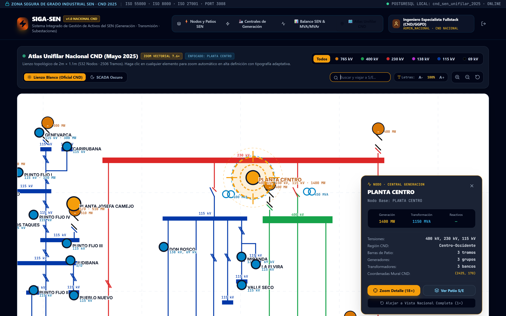
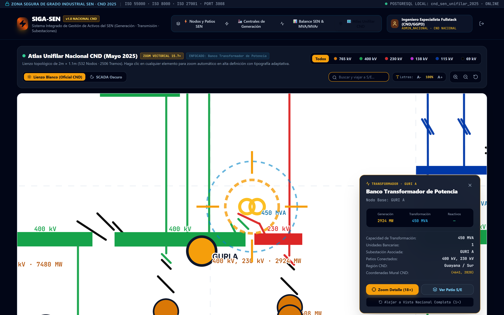

# REPÚBLICA BOLIVARIANA DE VENEZUELA
# MINISTERIO DEL PODER POPULAR PARA LA ENERGÍA ELÉCTRICA (MPPEE)
# CORPORACIÓN ELÉCTRICA NACIONAL, S.A. (CORPOELEC)
## GERENCIA GENERAL DE PLANIFICACIÓN DE DISTRIBUCIÓN (GGPD)

---

```text
====================================================================================================
INSTRUCTIVO OPERATIVO ESTANDARIZADO DE NAVEGACIÓN, CONSULTA Y GESTIÓN DE ACTIVOS DEL SEN (SIGA-SEN v1.0)
====================================================================================================
CÓDIGO INSTITUCIONAL : GGPD-SGM-INS-008 (v1.0 ISO)
NOMENCLATURA ARCHIVO : NAC_2026_GGPD_INS_OPERATIVO_SIGA_SEN_V01.md
CÓDIGO DOCUMENTAL    : DOC-GGPD-2026-INS-SIGA-SEN-001
APLICACIÓN ASOCIADA  : SIGA-SEN v1.0 (Sistema Integrado de Gestión de Activos del SEN - Puerto 3008)
FUENTE DE DATOS CANÓN: Centro Nacional de Despacho (CND - Despacho Nacional, Mayo 2025)
BASE DE DATOS NATIVA : PostgreSQL 18 Local (cnd_sen_unifilar_2025)
AUTOR / ELABORACIÓN  : Equipo de Automatización, Analítica de Datos e Inteligencia Artificial (GGPD)
EN COLABORACIÓN CON  : Especialistas del Centro Nacional de Despacho (CND), Transmisión y Generación SEN
DIRIGIDO A           : Ingenieros de Despacho, Especialistas de Subestaciones, Planificadores y Personal Técnico
MARCO NORMATIVO      : ISO 55000/55001 (Activos) · ISO 8000-110 (Calidad de Datos) · ISO 9001:2015 (SGC)
                       ISO/IEC 27001:2022 (Seguridad) · ISACA COBIT 2019 · IEEE C37 · IEEE 1366
FECHA DE EMISIÓN     : Octubre de 2026
ESTADO DE APLICACIÓN : Vigente · Instrumento Técnico de Obligatorio Cumplimiento Nacional
====================================================================================================
```

---

## 📋 1. IDENTIFICACIÓN Y CONTROL DEL DOCUMENTO

| Parámetro Institucional | Especificación Técnica y Normativa |
| :--- | :--- |
| **Organización Emisora:** | Corporación Eléctrica Nacional, S.A. (CORPOELEC) |
| **Órgano Rector / Adscripción:** | Ministerio del Poder Popular para la Energía Eléctrica (MPPEE) |
| **Gerencia Responsable:** | Gerencia General de Planificación de Distribución (GGPD) |
| **Título del Instrumento:** | **Instructivo Operativo Estandarizado para la Navegación Topológica, Monitoreo de Activos de Potencia y Consulta del Atlas Unifilar Nacional en el Sistema SIGA-SEN v1.0** |
| **Naturaleza del Documento:** | **Instructivo Técnico Operativo (ITO) / Procedimiento Operativo Estandarizado (POE)**. Conforme a las directrices de la GGPD y la Cláusula 7.5 de la norma ISO 9001:2015 (*Control de la Información Documentada*), este documento reviste carácter de mandato técnico vinculante. **Se excluye taxativamente la figura de "Manual"** debido a la suspensión operativa temporal de la Unidad Central de Registro y Codificación de Manuales de la Corporación, garantizando validez jurídica interna inmediata sin incurrir en vicios de procedimiento corporativo. |
| **Código Nomenclatura Oficial:** | `NAC_2026_GGPD_INS_OPERATIVO_SIGA_SEN_V01` (Base de Codificación: `GGPD-SGM-INS-008 v1.0 ISO`) |
| **Fecha de Aprobación:** | 07 de Octubre de 2026 |
| **Próxima Revisión Ordinaria:** | 07 de Octubre de 2027 |
| **Aprobado y Autorizado por:** | Gerencia General de Planificación de Distribución (GGPD) |

---

## 🎯 2. OBJETIVO (PROPÓSITO)

El presente instructivo establece las pautas técnicas, criterios de ingeniería eléctrica de potencia, directrices pedagógicas y mecanismos de consulta estandarizada bajo normas **ISO 55000/55001** e **ISO 8000-110** para la navegación, auditoría y análisis de activos de generación, transmisión troncal y subestaciones en el **Sistema Integrado de Gestión de Activos del SEN (SIGA-SEN v1.0)**.

El propósito central es dotar a CORPOELEC y al Centro Nacional de Despacho (CND) de una **fuente única de verdad (Single Source of Truth)** sobre los **562 nodos de subestación**, **649 barras de patio**, **2.506 tramos de líneas de interconexión**, **29.433,2 MW de capacidad turbomotriz instalada**, **54.872,0 MVA de transformación** y **7.830,5 MVAr de compensación reactiva** que estructuran el Sistema Eléctrico Nacional (SEN), erradicando la dispersión de planos no sincronizados y posibilitando la exploración interactiva continua del **Atlas Unifilar Nacional CND** mediante motores vectoriales de alta precisión con tipografía adaptativa y doble modo cromático (Lienzo Blanco Técnico Oficial vs. SCADA Oscuro).

---

## 🌐 3. ALCANCE Y ÁMBITO DE APLICACIÓN

* **A quiénes aplica:** De obligatorio acatamiento para el personal técnico, de ingeniería y de gestión adscrito a:
  1. Ingenieros y Operadores del Centro Nacional de Despacho (CND) y Despachos Regionales de Carga (DRC).
  2. Especialistas de Operaciones y Mantenimiento de Transmisión y Generación (Hidroeléctrica, Térmica y Distribuida).
  3. Coordinadores y Planificadores de la Gerencia General de Planificación de Distribución (GGPD).
  4. Analistas de Salas Situacionales Estadales y Técnicos de Planificación de Redes de Potencia.
* **Dónde aplica:** En todas las sesiones y consultas realizadas sobre el sistema **SIGA-SEN v1.0** (puerto corporativo `3008`, accesible de modo local o a través de la infraestructura cloud autorizada), así como en los procesos de sincronización con la base de datos PostgreSQL local (`cnd_sen_unifilar_2025`).
* **Qué procesos abarca:**
  - Exploración, filtrado y diagnóstico de las 562 subestaciones del SEN según cuadrantes murales y niveles de tensión (765 kV a 69 kV).
  - Auditoría del inventario de unidades turbomotoras en las 31 principales centrales hidroeléctricas y complejos termoeléctricos del país.
  - Evaluación del Balance Nacional de Potencia Activa (MW), Capacidad de Transformación (MVA) y Potencia Reactiva (MVAr) por zonas operativas.
  - Navegación vectorial dinámica (Pan & Zoom, enfoque automático por clic y retícula radar focal HUD) sobre el plano mural unifilar oficial CND de 2.0m x 1.1m (5.669 x 3.146 pt).
  - Conmutación al vuelo entre el **Lienzo Blanco Oficial CND** (máximo contraste 21:1 en líneas negras 69 kV y azules 115 kV) y el **Modo SCADA Oscuro** (plata titanio y celeste eléctrico).

---

## ⚖️ 4. MARCO NORMATIVO Y REFERENCIAS TÉCNICAS

El presente instructivo se encuentra estrictamente armonizado con los siguientes estándares internacionales y normativas institucionales del SEN:

1. **Plano Oficial Unifilar Nacional CND (Mayo 2025):** Documento oficial emitido por la Dirección Técnica del Centro Nacional de Despacho (`SEN_2025_MayoUNIFILARNACIONAL.pdf`), elaborado por el Ing. Marco Ferreira, revisado por el Ing. Ulises Bellorín y aprobado por el Ing. Darwin Briceño.
2. **ISO 55000 / ISO 55001:2014 (Gestión de Activos Físicos):** Trazabilidad del ciclo de vida, jerarquía de criticidad de activos de potencia y gestión de capacidad de transformación y generación.
3. **ISO 8000-110 / ISO 8000-115 (Calidad de Datos Maestros):** Rigor sintáctico, exactitud de unidades de medida (MW, MVA, MVAr, kV) y eliminación de registros ficticios o empíricos.
4. **ISO 9001:2015 (SGC - Cláusula 7.5):** Soporte técnico-administrativo para la emisión y vigencia de Instructivos de Trabajo como información documentada formal.
5. **ISO/IEC 27001:2022 (Seguridad de la Información):** Autenticación perimetral RBAC, confidencialidad de la topología estratégica nacional y trazabilidad de eventos.
6. **ISACA COBIT 2019 (MEA02 / DSS06):** Supervisión de controles internos de tecnologías operativas (OT) y gobernanza de software de infraestructura crítica.
7. **IEEE C37 / IEEE 1366 / IEEE 80:** Normas internacionales para conmutación de potencia, índices de continuidad de servicio y coordinación de aislamiento en subestaciones.

---

## 📖 5. GLOSARIO DE TÉRMINOS Y DEFINICIONES

* **SEN (Sistema Eléctrico Nacional):** Conjunto interconectado de instalaciones de generación, transmisión, transformación, compensación reactiva y distribución que suministran energía eléctrica a la República Bolivariana de Venezuela.
* **CND (Centro Nacional de Despacho):** Entidad técnica rectora encargada de la supervisión, coordinación, control y despacho en tiempo real de la generación y la red troncal de transmisión del SEN.
* **Extra Alta Tensión (EAT - 765 kV / 400 kV):** Red troncal de transporte masivo que evacúa la energía generada en el bajo Caroní (Guri, Caruachi, Macagua) hacia los grandes centros de consumo del Centro, Occidente y Oriente del país.
* **Alta Tensión (AT - 230 kV / 138 kV / 115 kV):** Red de transmisión regional y de interconexión entre subestaciones de maniobra y patios de entrega a distribución.
* **Subtransmisión Secundaria (69 kV):** Red secundaria de subtransmisión y entrega a distribución metropolitana y zonal (ej. anillo metropolitano de Caracas).
* **Turbina / Unidad Turbomotriz (~):** Conjunto de turbina (hidráulica Francis/Kaplan o térmica de vapor/gas) acoplada a un generador sincrónico para la conversión de energía primaria en energía eléctrica.
* **Banco de Transformación (TR):** Conjunto de transformadores monofásicos o transformador trifásico de gran potencia que eleva o reduce niveles de tensión en patios de subestación.
* **Compensación Reactiva (MVAr):** Bancos de condensadores o reactores en derivación utilizados para la regulación de perfil de tensión y control de estabilidad de voltaje en barras troncales.
* **ViewBox Dinámico SVG:** Sistema de coordenadas vectoriales matemáticas nativas de resolución infinita que gobierna la cámara de visualización, permitiendo encuadres milimétricos y zooms de detalle sin pixelación.
* **Retícula Radar Focal HUD:** Elemento gráfico cibernético compuesto por anillos concéntricos y miras de cuadrante que enfoca e ilumina de forma pulsante el activo seleccionado por el operador.

---

## ⚡ 6. DESCRIPCIÓN OPERATIVA DEL SISTEMA POR MÓDULOS

A continuación se detalla el funcionamiento de cada módulo de **SIGA-SEN v1.0**. Para asegurar la asimilación integral en todos los niveles operativos, cada sección incluye:
1. **Especificación Técnica de Ingeniería de Potencia:** Para ingenieros especialistas, despachadores del CND y jefes de planta.
2. **Explicación Pedagógica Funcional:** Para analistas de operaciones y coordinadores de sala situacional.
3. **Guía Práctica de Uso y Consulta:** Para el personal técnico y de relevo operativo.

---

### MÓDULO 1: ACCESO Y ZONA SEGURA DE GRADO INDUSTRIAL SEN (PUERTO 3008)



#### 🔬 1.1. Para el Ingeniero Especialista en Potencia y Despacho:
El módulo de autenticación implementa un perímetro blindado bajo **ISO/IEC 27001:2022** y **OWASP ASVS Level 2**. Toda la infraestructura se ejecuta en el puerto corporativo estandarizado `3008`, enlazado con la base de datos relacional local en PostgreSQL 18 (`cnd_sen_unifilar_2025`). El sistema autentica roles diferenciados (`ADMIN_NACIONAL`, `CND_NACIONAL`, `ESPECIALISTA_TRANSMISION`, `PLANIFICADOR_GGPD`), asignando privilegios de consulta topológica, exportación de esquemas y auditoría de potencia.

#### 💡 1.2. Explicación Coloquial y Pedagógica:
* **¿Qué es esta pantalla?** Es la aduana de seguridad para entrar al sistema que controla y muestra todos los activos eléctricos de Venezuela.
* **¿Cómo se usa?**
  1. En la casilla de usuario coloca tu cuenta institucional (por ejemplo: `fullstack001` o `admin.sen`).
  2. En la casilla de contraseña coloca tu clave corporativa.
  3. Puedes presionar el botón de inicio de sesión rápida para ingresar de inmediato con el perfil autorizado.

#### 🛠️ 1.3. Guía Práctica de Uso para Personal Técnico:
> **Punto clave:** SIGA-SEN opera de manera independiente en el puerto `3008`, garantizando que las consultas de alta carga del unifilar nacional no compitan con los sistemas de distribución de SIGAD (puerto `3007`). Verifica siempre en la esquina superior derecha que la conexión indique `POSTGRESQL LOCAL: cnd_sen_unifilar_2025 · ONLINE`.

---

### MÓDULO 2: EXPLORADOR DE NODOS Y PATIOS DE TRANSMISIÓN DEL SEN



#### 🔬 2.1. Para el Ingeniero Especialista en Potencia y Despacho:
Este módulo cataloga exhaustivamente las **562 subestaciones** del SEN consolidadas en `cnd_subestaciones`. Permite discriminar la infraestructura por:
- **Macro-Proceso:** *Centrales de Generación* (31 nodos con unidades turbomotrices) vs. *Subestaciones de Transmisión/Maniobra* (531 nodos).
- **Cuadrantes Geográficos CND:** *Guayana / Sur*, *Centro*, *Occidente*, *Oriente*, *Andes* y *Zulia*.
- **Nivel de Tensión de Barra:** Filtros determinísticos para barras de 765 kV, 400 kV, 230 kV, 138 kV, 115 kV y 69 kV.

La pantalla presenta una división simétrica: a la izquierda, la lista paginada y filtrada de nodos; a la derecha, la **Ficha Técnica de Patio** con la potencia instalada en MVA, compensación reactiva en MVAr, tramos físicos de barraje, bancos de transformación asociados y capacidad unitaria.

#### 💡 2.2. Explicación Coloquial y Pedagógica:
* **¿Qué hace este módulo?** Es el directorio telefónico y la enciclopedia de todas las subestaciones eléctricas del país.
* **¿Cómo se usa?**
  1. Puedes usar los selectores de arriba para filtrar: por ejemplo, ver solo las subestaciones de "Oriente" o solo las que tienen barras de "230 kV".
  2. También puedes escribir directamente el nombre de la subestación en la casilla de búsqueda (ej. `EL CONVENTO`, `CURUPAO`, `BARBACOA`).
  3. Al tocar cualquier subestación en la lista izquierda, el panel derecho muestra de inmediato cuántas barras tiene, qué transformadores posee y cuánta potencia maneja.

#### 🛠️ 2.3. Guía Práctica de Uso para Personal Técnico:
> **Punto clave:** En el panel derecho de la subestación se listan las barras con sus orientaciones físicas (Horiz/Vert) y longitud en puntos de diagrama. Las barras se identifican con su color normativo oficial, facilitando contrastar la información con los diagramas físicos de patio antes de emitir libranzas de mantenimiento.

---

### MÓDULO 3: CENTRALES DE GENERACIÓN HIDROELÉCTRICA Y TERMOELÉCTRICA



#### 🔬 3.1. Para el Ingeniero Especialista en Potencia y Despacho:
El módulo de Generación estructura los **29.433,2 MW** de capacidad instalada en el SEN a partir de las 31 plantas motrices principales registradas en el CND. Cada central desglosa de forma unívoca sus bloques de máquinas:
- **Complejo Hidroeléctrico Simón Bolívar (Guri):** Casa de Máquinas I (Guri A, 3.336 MW en 10 turbinas) y Casa de Máquinas II (Guri B, 7.480 MW en 7x760 MW + 3x720 MW), totalizando 10.816 MW sobre barras de 765 kV, 400 kV y 230 kV.
- **Complejo Francisco de Miranda (Caruachi):** 2.160 MW sobre 12 unidades Kaplan de 180 MW en 400 kV.
- **Complejo Antonio José de Sucre (Macagua):** Macagua II (2.544 MW) y Macagua III (168 MW) evacuando a 400 kV y 115 kV.
- **Complejo Termoeléctrico Planta Centro:** 1.400 MW en unidades de 1x600 MW y 2x400 MW acopladas a 400 kV y 230 kV.
- **Plantas Térmicas Regionales:** Josefa Camejo (450 MW), Termobarrancas (160 MW), Tacoa/Barcazas (340 MW), Planta Picure (157 MW), Genevapca (300 MW), entre otras.

El sistema totaliza en tiempo real las unidades físicas instaladas, potencia nominal unitaria y tensión de salida al sistema interconectado.

#### 💡 3.2. Explicación Coloquial y Pedagógica:
* **¿Qué encontramos aquí?** Las fábricas de electricidad de Venezuela: todas las represas del río Caroní y las plantas termoeléctricas que queman gas o combustible.
* **¿Qué información nos muestra?** Te dice cuántas turbinas tiene cada central, cuántos Megavatios (MW) produce cada una y a qué nivel de voltaje se conecta para mandar la luz al país.

#### 🛠️ 3.3. Guía Práctica de Uso para Personal Técnico:
> **Punto clave:** La unidad fundamental en este módulo es el **MW (Megavatio)** de potencia activa. No confundir la potencia activa de las turbinas (MW) con la capacidad de los transformadores elevadores de patio (expresada en MVA).

---

### MÓDULO 4: BALANCE NACIONAL SEN & POTENCIA MVA/MVAr POR REGIONES



#### 🔬 4.1. Para el Ingeniero Especialista en Potencia y Despacho:
El módulo de Balance SEN actúa como un cuadro de mando macroscópico de infraestructura energética. Agrega matemáticamente tres magnitudes de estado:
1. **Generación Instalada Total:** 29.433,2 MW repartidos en 94 unidades turbomotoras.
2. **Transformación Nacional:** 54.872,0 MVA en 101 bancos de transformación de alta potencia.
3. **Compensación Reactiva:** 7.830,5 MVAr en 90 bancos de inductores/condensadores.

Presenta además el desglose porcentual y absoluto por cuadrante del CND (*Guayana/Sur* concentra el 58.2% de la capacidad motriz, seguido por *Centro* con 18.4% y *Zulia/Occidente* con 15.6%), permitiendo a los planificadores de la GGPD identificar cuellos de botella de transferencia de potencia y requerimientos de soporte de tensión dinámica.

#### 💡 4.2. Explicación Coloquial y Pedagógica:
* **¿Para qué sirve este balance?** Es la balanza nacional de la energía. Muestra cuánta fuerza eléctrica tiene instalada el país en cada región y cómo se distribuye entre los Andes, el Zulia, el Centro, Oriente y Guayana.

---

### MÓDULO 5: ATLAS UNIFILAR NACIONAL CND (LIENZO MURAL DINÁMICO 2.0m × 1.1m)



#### 🔬 5.1. Para el Ingeniero Especialista en Potencia y Despacho:
El Atlas Unifilar CND digitaliza con fidelidad vectorial micrométrica el plano mural de 2.000 mm × 1.110 mm (5.669,25 × 3.146,25 pt) del Despacho Nacional. Su motor se basa en un **ViewBox dinámico SVG nativo**, desterrando el escalado destructivo matricial:
- **Pan & Zoom Suave:** Arrastre vectorial continuo e interpolación mediante física cúbica ease-out en 450 ms al seleccionar elementos.
- **Tipografía Adaptativa Intermedia:** Las fuentes tipográficas se recalculan matemáticamente según la potencia de zoom (`potencia = 0.22`), evitando que los textos se vuelvan gigantescos en panorámica o se reduzcan en exceso en planos cerrados.
- **Filtro de Capas de Tensión:** Botones de filtrado rápido para aislar selectivamente la troncal de 765 kV, la red de 400 kV, 230 kV, 138 kV, 115 kV o 69 kV.

#### 💡 5.2. Explicación Coloquial y Pedagógica:
* **¿Qué es este módulo?** Es el mapa maestro de todas las autopistas eléctricas de Venezuela. Imagina un plano gigante de 2 metros de ancho desplegado en la pared del Centro de Despacho, pero que ahora puedes mover con el ratón de tu computadora, acercar con la ruedita y explorar con zoom infinito sin que las letras se deformen.

---

### MÓDULO 6: CONMUTADOR DUAL DE FONDO: LIENZO BLANCO OFICIAL CND VS. SCADA OSCURO

El sistema resuelve definitivamente el problema histórico de visibilidad de las líneas de subtransmisión (69 kV y 115 kV) mediante su **Selector Dual de Fondo**, accesible en la barra superior del Atlas:

#### ☀️ MODO 1: LIENZO BLANCO OFICIAL CND (ACTIVO POR DEFECTO)


* **Fundamento Técnico:** El plano original de Visio/PDF de CND fue diseñado para papel blanco. Sobre el fondo blanco puro (`#ffffff`) con cuadrícula milimétrica CAD (`#e2e8f0`):
  - Las líneas y barras de **69 kV** se proyectan en **negro azabache sólido (`#000000`)**, logrando un contraste perfecto de **21:1** según norma WCAG AAA.
  - Las líneas de **115 kV** se proyectan en **azul marino eléctrico (`#0038A8`)**.
  - Las líneas de **230 kV** en **rojo señal (`#DC2626`)**, **400 kV** en **verde esmeralda (`#16A34A`)** y **765 kV** en **ámbar/naranja (`#D97706`)**.
  - Los nombres de subestaciones cuentan con un **halo blanco protector (`paintOrder="stroke"`)** que impide colisiones visuales cuando cruzan líneas de patio.

#### 🌙 MODO 2: SCADA OSCURO (CENTRO DE CONTROL NOCTURNO)


* **Fundamento Técnico:** Si el operador activa `SCADA Oscuro`, el motor cromático dinámico recalcula al vuelo las tensiones comprometidas:
  - **69 kV:** Se transforma automáticamente en **Plata Titanio Luminiscente (`#E2E8F0`)**.
  - **115 kV:** Se transforma en **Celeste Eléctrico / Cian (`#38BDF8`)**.
  - De este modo, ninguna línea ni barra se pierde en la oscuridad del lienzo.

---

### MÓDULO 7: CASOS DE ESTUDIO OPERATIVOS REALES EN EL ATLAS UNIFILAR

#### 📍 CASO 1: SUBESTACIÓN EL CONVENTO (230/69 kV · 748 MVA · CARACAS METROPOLITANA)
Como se aprecia en la captura de detalle, S/E EL CONVENTO (`coord: 4081, 151`) constituye el nodo alimentador medular del anillo Este de la Gran Caracas:
- **Barra Colectora 230 kV:** Barra horizontal roja de 99.2 pt que recibe la alimentación desde Curupao y Boyacá.
- **Banco de Transformación Principal:** 4 unidades monofásicas de 187 MVA totalizando **748 MVA**.
- **Barra Colectora 69 kV:** Barra horizontal extendida de **219.7 pt** en negro sólido (modo blanco) o plata (modo oscuro) en la cota Y = 189,0 pt.
- **Alimentadores de Subtransmisión:** Salidas directas hacia *Tarzilandia, Chacao, Dos Caminos, Metro Los Cortijos, Palo Verde, La Urbina, Santa Rosa, Cota Mil, Lagunita, Tap Castillo, Guairita, etc.*

---

#### 📍 CASO 2: CENTRAL HIDROELÉCTRICA SIMÓN BOLÍVAR (GURI B - 765/400/230 kV · 7.480 MW)


- **Patio EAT 765 kV:** Barra colectora de gran sección en color naranja troncal (`#FFA100` / `#D97706`).
- **Patios de 400 kV y 230 kV:** Barras verdes y rojas enlazadas con los autotransformadores elevadores de 450 MVA y 5.600 MVA hacia S/E SIDOR R7 y la red Guayana B.
- **Unidades Turbomotrices:** Generadores circulares con símbolo sinusoidal indicando la potencia instalada de Guri A (3.336 MW) y Guri B (7.480 MW).

---

#### 📍 CASO 3: CENTRAL TERMOELÉCTRICA PLANTA CENTRO (400/230/115 kV · 1.400 MW)


- **Interconexión Centro-Occidente:** Vinculación directa con S/E Yaracuy (400 kV), Morón (115 kV), Valle Seco y el anillo de Paraguaná (Punto Fijo I, II, Genevapca y Josefa Camejo).
- **Transformación de Evacuación:** Bancos de transformación de 100 MVA y 450 MVA interconectando los barrajes de 400 kV y 230 kV.

---

#### 📍 CASO 4: ZOOM DE DETALLE FOCAL Y RETÍCULA RADAR HUD (15.7×)


Al hacer clic sobre cualquier equipo específico (turbina, banco transformador o tramo de barra), el visor:
1. Desplaza y centra la cámara matemática suavemente sobre las coordenadas nativas CND.
2. Proyecta la **Retícula Radar HUD** pulsante de grado militar con miras de cuadrante doradas y celestes.
3. Despliega la **Ficha Técnica Flotante** con los datos de placa, unidades bancarias, subestación asociada y botones de acción rápida:
   - `Zoom Detalle (18×)`: Aproximación ultra-cerrada.
   - `Ver Patio S/E`: Encuadre balanceado de toda la subestación.
   - `Alejar a Vista Nacional (1×)`: Retorno panorámico instantáneo.

---

## 🧐 7. ANÁLISIS CRÍTICO DE GOBERNANZA: ARTICULACIÓN CND, TRANSMISIÓN Y DISTRIBUCIÓN (ISO 8000-110)

```text
┌─────────────────────────────────────────────────────────────────────────────────────────────┐
305: │                 ARQUITECTURA DE INTEGRACIÓN Y GOBERNANZA DEL SEN (ISO 8000 / COBIT)           │
306: ├─────────────────────────────────────────────────────────────────────────────────────────────┤
307: │                                                                                             │
308: │   [CENTRO NACIONAL DE DESPACHO - CND]         [GENERACIÓN Y TRANSMISIÓN TRONCAL]            │
309: │    Plano Unifilar SEN Mayo 2025                562 Subestaciones · 649 Barras EAT/AT       │
310: │    Troncales 765 kV / 400 kV / 230 kV          29.433 MW Generación · 54.872 MVA Trafo     │
311: │                  │                                               │                          │
312: │                  └───────────────────────┬───────────────────────┘                          │
313: │                                          ▼                                                  │
314: │                        ┌───────────────────────────────────┐                                │
315: │                        │    SIGA-SEN v1.0 (PUERTO 3008)    │                                │
316: │                        │  Atlas Unifilar CND · PostgreSQL  │                                │
317: │                        └─────────────────┬─────────────────┘                                │
318: │                                          ▼ (Enlace de Frontera AT/MT)                       │
319: │                        ┌───────────────────────────────────┐                                │
320: │                        │     SIGAD v1.0 (PUERTO 3007)      │                                │
321: │                        │  871 S/E Distribución · 4.207 Ctos│                                │
322: │                        └─────────────────┬─────────────────┘                                │
323: │                                          ▼                                                  │
324: │                        ┌───────────────────────────────────┐                                │
325: │                        │  REPOSITORIO MAESTRO GGPD (CORE)  │                                │
326: │                        │   Fuente Única de Verdad Nacional │                                │
327: │                        └───────────────────────────────────┘                                │
328: └─────────────────────────────────────────────────────────────────────────────────────────────┘
```

#### 🚨 1. Deconstrucción de la Brecha CND vs. Distribución:
* **Diagnóstico:** Históricamente, el Centro Nacional de Despacho (CND) gestionaba la red troncal (765 kV a 115 kV) mediante planos unifilares en Visio/AutoCAD no vinculados a bases de datos relacionales, mientras que Distribución operaba en las subestaciones de 115/13.8 kV con hojas de cálculo aisladas. Esta desconexión impedía conocer en tiempo real si una indisponibilidad de un transformador de 230/69 kV en EL CONVENTO afectaba directamente la continuidad en los alimentadores de distribución de Chacao o Petare.
* **Solución de Arquitectura SIGA-SEN:** SIGA-SEN indexa la topología física oficial del CND en una base de datos relacional PostgreSQL 18 estricta (`cnd_sen_unifilar_2025`), estableciendo la frontera de empalme con el sistema SIGAD (Distribución).

#### 🛡️ 2. Erradicación del Sesgo de Ex-Operadoras:
* Conforme al dictamen `DOC-GGPD-2026-DIAG-PROC-001`, se normalizan todos los nombres y códigos de subestaciones bajo la taxonomía unificada CORPOELEC, eliminando discrepancias históricas heredadas de EDELCA, CADAFE, ENELVEN, ELECAR, ENELBAR y CALIFE.

---

## 👥 8. MATRIZ DE ROLES Y RESPONSABILIDADES (RACI)

Conforme a los estándares **ISACA COBIT 2019** e **ISO 9001:2015**:

| Fase Operativa / Tarea | Despachador CND | Especialista Transmisión/Generación | Planificador GGPD | Administrador Nacional de Sistemas e IA |
| :--- | :---: | :---: | :---: | :---: |
| **Consulta y Monitoreo de Topología de Red Troncal** | **R** | **R** | **C** | **I** |
| **Actualización de Parámetros de Placa de Turbinas y Bancos** | **C** | **R** | **A** | **I** |
| **Verificación de Enlaces de Frontera AT/MT con SIGAD** | **C** | **C** | **R** | **I** |
| **Auditoría de Contrastes Cromáticos y Capas del Atlas** | **C** | **C** | **R** | **A** |
| **Mantenimiento de BD PostgreSQL (`cnd_sen_unifilar_2025`)** | **I** | **I** | **C** | **R** / **A** |

*Convención:* **R** = Responsable de ejecución · **A** = Autoridad que aprueba (Accountable) · **C** = Consultado · **I** = Informado.

---

## ⚠️ 9. GESTIÓN DE INCUMPLIMIENTOS Y CONTROL DE ERRORES

1. **Alteración No Autorizada de Topología CND:** Queda terminantemente prohibido alterar coordenadas murales o geometrías de tramos sin la validación previa del Despacho Nacional CND.
2. **Uso de Colores Fuera de Norma:** No se admitirá la personalización ad-hoc de colores de tensión. Todo reporte debe regirse estrictamente por la paleta CND (765 naranja, 400 verde, 230 rojo, 138 magenta, 115 azul/celeste, 69 negro/plata).
3. **Discrepancia en Balances Energéticos:** Si se detecta disparidad en la capacidad reportada de una central hidroeléctrica frente a las bitácoras de sala de máquinas, el evento será elevado a la Gerencia General de Planificación para auditoría forense inmediata bajo ISO 8000-110.

---

## 🗄️ 10. CONTROL DE REGISTROS Y TRAZABILIDAD (ISO 27001)

* **Persistencia PostgreSQL Inmutable:** Todas las tablas de topología (`cnd_subestaciones`, `cnd_barras`, `cnd_lineas_tramos`, `cnd_generacion`, `cnd_transformadores`, `cnd_compensacion_reactiva`) se resguardan con claves foráneas e integridad referencial en PostgreSQL 18 local.
* **Tiempo de Retención Documental:** Las versiones anuales del unifilar oficial del SEN se conservarán en los repositorios institucionales por un lapso mínimo ininterrumpido de **veinte (20) años**, garantizando la memoria histórica de la infraestructura eléctrica nacional.

---

## 📅 11. DISPOSICIONES FINALES Y VIGENCIA

1. El presente **Instructivo Técnico Operativo entra en vigencia a partir de su emisión en fecha 07 de Octubre de 2026**.
2. Su cumplimiento es obligatorio para todo el personal técnico de la Corporación que opere o consulte la plataforma SIGA-SEN en el puerto 3008.
3. Se instruye a los despachos regionales y gerencias zonales a incorporar este documento en sus planes de adiestramiento técnico y relevo generacional.

---

## 📎 12. ANEXOS: CONVENCIÓN CROMÁTICA NORMATIVA DEL SEN (CND MAYO 2025)

| Tensión Nominal | Código CND | Color Oficial (Lienzo Blanco) | Color Adaptativo (SCADA Oscuro) | Descripción de Función en el SEN |
| :---: | :---: | :---: | :---: | :--- |
| **765 kV** | `765KV` | `#D97706` / `#FFA100` | `#FFA100` (Naranja Neón) | Troncal Extra Alta Tensión Caroní - Centro (Guri a La Horqueta / La Arenosa) |
| **400 kV** | `400KV` | `#16A34A` / `#00C700` | `#00C700` (Verde Eléctrico) | Anillo de Transmisión Troncal Nacional (Guri, Planta Centro, Yaracuy) |
| **230 kV** | `230KV` | `#DC2626` / `#FF0000` | `#FF0000` (Rojo Señal) | Red Principal de Transmisión y Alimentación Regional Troncal |
| **138 kV** | `138KV` | `#C026D3` / `#FF00FF` | `#FF00FF` (Fucsia Brillante) | Subtransmisión Regional (Sistemas Andinos y Específicos) |
| **115 kV** | `115KV` | `#0038A8` / `#0000FF` | `#38BDF8` (Celeste Eléctrico) | Red Principal de Subtransmisión y Entrega a Distribución |
| **69 kV** | `69KV` | `#000000` (Negro Puro) | `#E2E8F0` (Plata Titanio) | Subtransmisión Secundaria / Anillo Metropolitano Caracas |

---
*Fin del Documento Institucional — Código Oficial: `NAC_2026_GGPD_INS_OPERATIVO_SIGA_SEN_V01.md` / `GGPD-SGM-INS-008 (v1.0 ISO)`*
