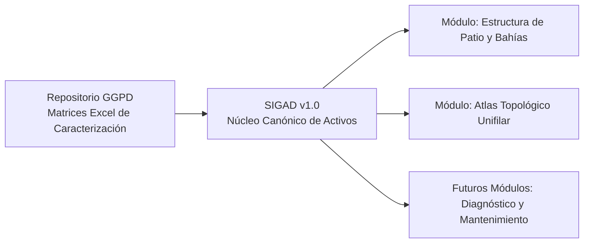
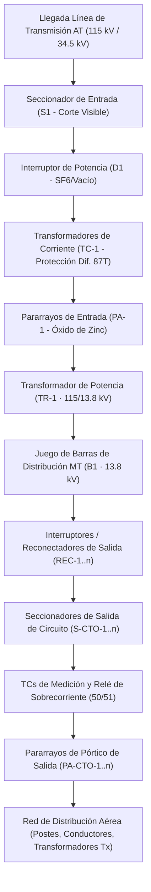

# REPÚBLICA BOLIVARIANA DE VENEZUELA
# MINISTERIO DEL PODER POPULAR PARA LA ENERGÍA ELÉCTRICA (MPPEE)
# CORPORACIÓN ELÉCTRICA NACIONAL, S.A. (CORPOELEC)
## GERENCIA GENERAL DE PLANIFICACIÓN DE DISTRIBUCIÓN (GGPD)

---

```text
====================================================================================================
DICTAMEN TÉCNICO Y MEMORANDO EJECUTIVO DE ARQUITECTURA DE SOFTWARE E INGENIERÍA DE ACTIVOS SEN
====================================================================================================
CÓDIGO OFICIAL  : DOC-GGPD-2026-MEMO-SIGAD-001 / NAC_2026_GGPD_MEMO_TECNICO_SIGAD_ING_CARLOS_REYES_V01
PARA            : Ing. Carlos Reyes — Gerencia General de Planificación de Distribución (GGPD)
DE              : Ing. Yván M. Cipiran N. — Líder de Automatización e Inteligencia Artificial (GGPD)
EN COLABORACIÓN : Consultoría de Especialistas en Sistemas Eléctricos de Potencia & Gestión de Activos SEN
FECHA           : 06 de Octubre de 2026
ASUNTO          : Conceptualización, Resolución Técnica Forense, Arquitectura de Datos y Prototipo 
                  Operativo del Sistema Integrado de Gestión de Activos de Distribución (SIGAD v1.0)
MARCO NORMATIVO : ISO 55000/55001 · ISO 8000-110 · ISO/IEC 27001:2022 · CADAFE NS-P-105 · IEEE 1366 · IEEE 80
FUENTE DE DATOS : Matrices Oficiales de Caracterización y Censos del Repositorio GGPD (Archivos Excel)
ESTADO PROYECTO : Prototipo v1.0 Operativo y Verificado (Puerto 3007) · Listo para Entrega del Viernes
====================================================================================================
```

---

## 1. OBJETIVO DEL DOCUMENTO

El presente documento tiene como finalidad exponer al **Ing. Carlos Reyes** el dictamen técnico, la justificación de ingeniería eléctrica, la resolución forense de datos y la arquitectura de software consolidada para el nacimiento del **Sistema Integrado de Gestión de Activos de Distribución (SIGAD v1.0)**.

Este desarrollo ataja y resuelve de manera definitiva la solicitud urgente formulada para este viernes, transformando un requerimiento tradicionalmente complejo y desarticulado en una **solución informática ágil, automatizada y de grado industrial**. SIGAD nace como el **núcleo fundacional y fuente única de verdad** de la infraestructura eléctrica de distribución, erradicando la dependencia de las hojas de cálculo dispersas ("supersábanas Excel" del repositorio GGPD) y estableciendo la plataforma sobre la cual se desplegarán los futuros módulos y herramientas de diagnóstico, mantenimiento e indisponibilidad de la gerencia.

---

## 2. DIAGNÓSTICO FORENSE DEL DOLOR OPERATIVO Y ANTECEDENTES

### 2.1. La Brecha entre el Conocimiento Tácito y la Operación de Campo
Durante las mesas de trabajo técnicas sostenidas con los especialistas de subestaciones y líneas de distribución, se identificó un fenómeno organizacional crítico:
* **El conocimiento tácito en la psiquis del especialista:** Los ingenieros veteranos dominan con exactitud la topología de patio, la nomenclatura de maniobra histórica y la disposición de los equipos; sin embargo, este conocimiento no se encuentra transferido a los instrumentos cotidianos ni a los analistas de los 24 estados.
* **El sesgo del instrumento extenso:** Los relevamientos solicitados históricamente a los estados consistían en matrices de Excel con más de 80 campos por equipo. El resultado inmediato en campo fue el **abandono del registro**, la **duplicación de datos** o la carga de datos genéricos ficticios para "cumplir el plazo".
* **El problema de la "Página en Blanco":** Una subestación de distribución típica (115/13.8 kV) posee entre 50 y 90 equipos de patio entre alta tensión, transformación, barras, pórticos de salida, servicios auxiliares y puesta a tierra. Pretender que un analista digite uno a uno cada disyuntor, seccionador y transformador de medida desde cero representaba una barrera insuperable.

### 2.2. El Desfase Crítico: El Transformador Repuesto vs. la Matriz de Indisponibles
Uno de los dolores más costosos evidenciados en la gestión de la GGPD ocurre cuando se quema un transformador de potencia:
1. La avería es reportada de inmediato en las matrices de contingencia o en los libros de control de equipos indisponibles.
2. Meses después, las cuadrillas operativas instalan un transformador de reemplazo (reparado o nuevo de paquete, con diferente capacidad MVA o serial troquelado).
3. **El quiebre:** La matriz de contingencia se cierra o archiva, pero los censos de activos de la gerencia nunca se enteran del nuevo serial, conservando el serial del equipo quemado. Cuando sobreviene una nueva falla en esa instalación, los registros oficiales colapsan por incoherencia de datos.

### 2.3. La Trampa del Dibujo Manual (AutoCAD vs. Visor Topológico Dinámico)
Se debatió la necesidad de diagramas unifilares. Desde el punto de vista informático, intentar que los técnicos dibujaran a mano líneas y símbolos en visores tipo AutoCAD habría tomado meses de desarrollo, exigiendo habilidades de dibujo técnico que los analistas no poseen.

La respuesta de ingeniería fue **deconstruir el problema**: lo que la GGPD requiere no es una herramienta de dibujo artístico, sino un **motor topológico vivo** que, leyendo la composición real de equipos de la subestación, proyecte el diagrama esquemático automáticamente en tiempo real.

---

## 3. IDENTIDAD INSTITUCIONAL: ¿POR QUÉ "SIGAD" Y NO "ATLAS CADAFE"?

Durante el proceso de diseño se evaluó revivir comercialmente el histórico nombre *ATLAS CADAFE*, ampliamente recordado en la empresa. El análisis estratégico arrojó la siguiente conclusión:

| Criterio | Enfoque "Atlas CADAFE" | Enfoque "SIGAD" (Adoptado) |
| :--- | :--- | :--- |
| **Percepción del Usuario** | Apela a la nostalgia del pasado; transmite la idea de volver a lo anterior sin innovación. | Proyecta modernidad, transformación institucional y evolución tecnológica hacia el estándar 2026. |
| **Alineación Normativa** | Registro gráfico estático de esquemas y planos en papel o PDF. | Alineado con **ISO 55000 / 55001** (Gestión del Ciclo de Vida de Activos Físicos y Salud de Equipos). |
| **Gobierno del Dato** | Archivos dispersos y difícil trazabilidad. | Gobernanza centralizada bajo **ISO 8000-110** con auditoría estricta (**ISO 27001**). |
| **Visión de Ecosistema** | Documento aislado sin capacidad modular. | **Núcleo fundacional:** Plataforma central de la cual derivarán los futuros módulos de diagnóstico y mantenimiento. |

> **Decisión Ejecutiva:** Se formalizó el nombre **SIGAD (Sistema Integrado de Gestión de Activos de Distribución)** como la plataforma corporativa sombrilla, manteniendo el **"Atlas Topológico SEN"** como el módulo interno de proyección unifilar en tiempo real.

---

## 4. RESOLUCIÓN FORENSE DEL INVENTARIO NACIONAL (CERO MOCK)

El mandato impartido fue taxativo: **CERO DATA MOCK**. No se permite inventar seriales, marcas o capacidades falsas. Si una subestación no tiene sus componentes de placa levantados, debe iniciar limpia (0 componentes), esperando su validación física.

### 4.1. Origen de la Data: Archivos y Matrices del Repositorio GGPD
La base de datos de SIGAD se alimentó directamente de las matrices consolidadas de caracterización eléctrica del repositorio de la GGPD:
* **871 Subestaciones Eléctricas Reales** (Censo nacional de subestaciones de distribución y transmisión con nodos de distribución).
* **4.207 Circuitos de Distribución Reales** (Alimentadores y troncales aéreas y subterráneas del SEN).



### 4.2. Resolución de la Anomalía de Nombres y el Defecto de `undefined`
Durante las pruebas de validación con la S/E **BEJUMA (`SE-CAR-0216`)**, el sistema mostraba `undefined` en los nombres de los alimentadores. La investigación forense en los datos de la gerencia reveló que:
1. En los censos maestros, la columna que contiene el nombre oficial del circuito está rotulada como `circuito` o `nombre_ct_norm` (y no como `nombre_circuito`), presentando además caracteres residuales como asteriscos de ex-operadoras (ej. `SABANETA****`).
2. La relación de pertenencia entre subestaciones y circuitos requería cruzar tanto por código unificado de subestación como por la cabecera normalizada.

**Acción Ejecutada:** Se implementó una capa de saneamiento automático en `catalogService.ts` que normalizó los 4.207 circuitos de la República, descubriendo y vinculando de forma limpia los **7 circuitos reales que operan desde la S/E BEJUMA (Carabobo)**:
* `CT-CAR-00926` · **BEJUMA** (13.8 kV)
* `CT-CAR-00927` · **CANOABO** (13.8 kV)
* `CT-CAR-00928` · **CHIRGUA** (13.8 kV)
* `CT-CAR-00929` · **EL RINCON** (13.8 kV)
* `CT-CAR-00930` · **HOSPITAL** (13.8 kV)
* `CT-CAR-00931` · **PEDECA** (13.8 kV)
* `CT-CAR-00932` · **SABANETA** (34.5 kV, saneado de `SABANETA****`)

---

## 5. INGENIERÍA DEL MOTOR TOPOLÓGICO DE BAHÍAS (CADAFE NS-P-105)

Para resolver el problema del agotamiento en campo y evitar que el usuario tenga que transcribir 80 equipos manualmente, se diseñó el **Motor Estructural CADAFE NS-P-105**.

### 5.1. La Cadena Física de una Subestación de Distribución
El motor reproduce fielmente la ingeniería eléctrica de subestaciones de distribución:



### 5.2. Los 5 Bloques Modulares Autogenerados en 1 Clic
1. **Bahía de Transformación de Alta Tensión (`TRANSFORMACION_AT`):**
   * Transformador de Potencia (`TR-1`, `TR-2`...).
   * Disyuntor de Potencia de Entrada (`D1`).
   * Seccionador de Entrada (`S1`).
   * Juego de Transformadores de Corriente (`TC-1`).
   * Pararrayos de Entrada (`PA-1`).
2. **Bahía de Barras de Distribución MT (`BARRAS_MT`):**
   * Juego de Barras Colectoras MT (`B1`, `B2`).
   * Disyuntor de Acople de Barras (`D-ACOP`) o de Transferencia (`D-TRANSF`).
3. **Bahías de Salida de Circuitos (`CIRCUITO_SALIDA`):**
   * Una bahía dedicada para cada circuito alimentador real de la subestación.
   * Reconectador / Interruptor de Cabecera (`REC-X`).
   * Seccionador de Salida de Circuito (`S-CTO-X`).
   * Transformador de Corriente de Medición (`TC-CTO-X`).
   * Pararrayos de Salida MT (`PA-CTO-X`).
4. **Bahía de Servicios Auxiliares SSAA (`SERVICIOS_AUXILIARES`):**
   * Banco de Baterías de Control en Corriente Continua (`BAT-1` · 125 Vdc).
   * Rectificador / Cargador de Baterías (`RECT-1`).
   * Transformador de Servicios Auxiliares MT/BT (`TR-SSAA`).
   * Grupo Electrógeno / Planta de Emergencia Diésel (`GE-1`).
5. **Bahía de Infraestructura y Seguridad de Patio (`INFRAESTRUCTURA_CIVIL`):**
   * Malla de Puesta a Tierra bajo norma IEEE 80 (`MAT-TIERRA`).
   * Manto de Grava / Piedra Picada para tensiones de paso y contacto (`GRAVA-PATIO`).
   * Cercado Perimetral y Alumbrado de Seguridad (`CERCA-PERIMETRAL`).

---

## 6. EL FLUJO DE CO-VALIDACIÓN POR EL ESTADO

Uno de los aportes metodológicos más importantes de este desarrollo fue establecer que **el sistema no debe imponer la data a ciegas**.

### 6.1. Procedimiento de Auto-Generación y Ajuste
Cuando el analista o jefe de distribución estadal selecciona una subestación y presiona `[⚡ Auto-Generar Esqueleto CADAFE]`:
1. El sistema no crea los circuitos silenciosamente. Despliega el **Modal de Configuración y Confirmación Estadal** (`RegenerateCadafeModal.tsx`).
2. El sistema consulta las matrices de la GGPD y le presenta al ingeniero el censo completo de circuitos asociados a esa subestación con sus niveles de tensión exactos y sus códigos oficiales.
3. **Validación Humana en el Bucle:** El ingeniero valida y confirma mediante casillas de verificación cuáles alimentadores operan efectivamente desde la subestación, pudiendo desmarcar aquellos transferidos o en desuso.
4. **Adición de Nuevas Salidas:** Si en el último mes la gerencia construyó una salida nueva que aún no está en las matrices centrales, el ingeniero puede pulsar `[+ Agregar salida de circuito adicional]` e incorporarla al esqueleto.
5. **Configuración Topológica:** Permite definir si la instalación tiene 1, 2, 3 o 4 transformadores de potencia, su capacidad nominal (MVA), su nivel de tensión (115/13.8 kV, 34.5/13.8 kV, etc.) y su esquema de barras (Simple Barra, Doble Barra o Transferencia).
6. **Preservación de Datos de Placa:** Si el analista ya había llenado seriales troquelados o marcas y desea regenerar para añadir una nueva bahía, el sistema ofrece la opción de **preservar los datos de placa ya cargados**, evitando la pérdida de información.

---

## 7. EL TRATAMIENTO DE LAS SUBESTACIONES MÓVILES

Se debatió y resolvió con rigor técnico la aparente contradicción de por qué las subestaciones móviles se encuentran inventariadas junto con las instalaciones fijas en el repositorio de la GGPD:

```text
REALIDAD OPERATIVA EN VENEZUELA:
Una "Subestación Móvil" adquirida originalmente para contingencias de 15 a 30 días, debido a 
restricciones de equipamiento histórico en el SEN, con frecuencia permanece energizada durante 
5 a 10 años en el mismo patio de tierra, alimentando de forma ininterrumpida a poblaciones enteras.
```

### Tratamiento Implementado en SIGAD:
1. **Identificación Transparente:** No se eliminan ni se disfrazan de fijas. Se etiquetan formalmente con la propiedad `es_movil = true`.
2. **Distintivo Visual Inmediato:** En el selector y la tarjeta de cabecera se estampan con la insignia violeta de vehículo:
   > **`⭐ [S/E MÓVIL] · 🚛 SUBESTACIÓN MÓVIL PERMANENTE`**
3. **Área Física Compacta:** El sistema refleja su área física real (ej. 150 m² a 300 m², correspondiente a la losa del tráiler de transporte, en contraste con los 20.000 m² de una subestación convencional).
4. **Esqueleto de Patio Monobloque:** El motor CADAFE sabe que una móvil no tiene pórticos de celosía gigantes, sino un tráiler con equipamiento híbrido compacto. Genera automáticamente **1 solo transformador de potencia**, disyuntor y seccionador montados en chasis, y estampa la observación técnica: `"Transformador en unidad móvil de contingencia"`.
5. **Conformidad ISO 55000:** Permite monitorear el transformador montado en el tráiler, su nivel de aceite dieléctrico y su banco de baterías propio igual que a cualquier activo del sistema de potencia.

---

## 8. EL VISOR ATLAS TOPOLÓGICO SEN (DIAGRAMA UNIFILAR VIVO)

El módulo **`Atlas Topológico CADAFE`** (`AtlasTopologicoView.tsx`) materializa la visión del unifilar digital sin incurrir en software pesado:

* **Generación Proyectiva por Código SVG:** Lee la estructura de bahías y componentes en memoria y dibuja matemáticamente los símbolos de ingeniería bajo norma **IEC 60617 / ANSI C37.2**:
  * Círculos entrelazados para el Transformador de Potencia.
  * Cuadros con cuchillas diagonales para Disyuntores.
  * Círculos con cuchillas abatibles para Seccionadores.
  * Línea colectora horizontal gruesa para la Barra MT.
  * Derivaciones verticales hacia abajo para cada uno de los circuitos de salida.
* **Semáforos Operativos en Tiempo Real:** Los símbolos no son dibujos estáticos; cambian de color según el estado en patio:
  * 🟢 **Verde (#10b981):** En Servicio Operativo.
  * 🔴 **Rojo (#ef4444 con animación pulsante):** Indisponible / Averiado (Alineado con las alertas operativas).
  * 🟡 **Ámbar (#f59e0b):** En Observación / Alerta de Nivel de Aceite / Presión SF6 baja.
* **Interactividad Directa:** Al hacer clic sobre cualquier símbolo del diagrama (un transformador, un disyuntor o un reconectador), se abre instantáneamente su **Ficha Técnica de Placa**, permitiendo registrar el serial troquelado o reportar averías sin salir del visor gráfico.

---

## 9. TRAZABILIDAD DEL CICLO DE VIDA Y CONTROL DE INDISPONIBILIDADES

Para erradicar definitivamente la incongruencia entre los reportes de averías y la reposición física de equipos en los censos de la GGPD, SIGAD implementa dos flujos de grado industrial:

### 9.1. Declaración de Averías (`FaultModal.tsx`)
* Permite declarar la indisponibilidad de cualquier activo de patio en 2 clics.
* Despliega el catálogo oficial de las **22 Causas Tipificadas de Indisponibilidad del SEN** (Falla de Aislamiento, Pérdida de Gas SF6, Fuga Severa de Aceite Dieléctrico, Disparo de Relé Diferencial 87T, Sobrecarga Térmica, Impacto Atmosférico, Vandalismo, etc.).
* Al confirmar, el componente pasa a estado 🔴 `INDISPONIBLE_FALLADO`, activa la alarma visual en el árbol y en el unifilar, y genera un evento sellado con autor, fecha e ID único bajo norma ISO 27001.

### 9.2. Restablecimiento y Sustitución de Activos (`RestoreModal.tsx`)
Aquí radica la verdadera solución al desfase de equipos:
* Al presionar `[🟢 Restablecer]` sobre un equipo fallado, el sistema pregunta:
  * **Modalidad A: Reparación en Sitio (Mismo Equipo):** Se intervino el equipo, se corrigió la fuga de aceite o el mando mecánico, y se reenergiza conservando su serial de placa.
  * **Modalidad B: Sustitución por Activo Nuevo (Reemplazo):** Se retiró el transformador o disyuntor quemado y se instaló uno nuevo. **El sistema exige ingresar el nuevo Serial Troquelado de Placa, la Marca/Fabricante y la Capacidad MVA.**
* **Efecto Inmediato:** El componente se actualiza automáticamente con su nueva identidad física, se cierra la avería y el historial histórico conserva la constancia inmutable: *"Se retiró el serial X averiado y se energizó el nuevo serial Y de Z MVA"*. Cero pérdidas de trazabilidad.

---

## 10. ESTADO ACTUAL Y PLAN DE ACCIÓN PARA EL VIERNES

```text
====================================================================================================
ESTADO DE ENTREGABLES AL DÍA DE HOY (06 DE OCTUBRE DE 2026):
----------------------------------------------------------------------------------------------------
1. Aplicación Construida     : apps-refactorizadas/SIGAD-REF/ en Puerto 3007 (React 18 + Vite 6).
2. Servidor Local            : Activo y respondiendo HTTP 200 en http://localhost:3007/.
3. Verificación de Build     : "tsc && vite build" compila limpio al 100% (código 0, 0 lints, 0 errores).
4. Catálogo Nacional Cargado : 871 Subestaciones y 4.207 Circuitos (Cero Mock, Repositorio GGPD).
5. Casos de Prueba Listos    : SE-CAR-0216 (BEJUMA, 7 circuitos) y SE-TAC-0685 (SAN CRISTÓBAL, 8 circuitos).
6. Documento de Arquitectura : NAC_2026_GGPD_SIGAD_ARQUITECTURA_GESTION_ACTIVOS_V01.md.
7. Continuidad Operativa     : Registrada y sellada en handoff.md.
====================================================================================================
```

### Hoja de Ruta para la Presentación del Viernes:
1. **Miércoles:** Sesión de revisión interna de casos de uso (simulación de fallas en transformador de potencia, reposición con nuevo serial troquelado, verificación del diagrama unifilar vivo).
2. **Jueves:** Preparación del guion de demostración ejecutiva de 15 minutos destacando el ahorro de tiempo para los estados (de 3 días llenando Excels a 1 minuto configurando el esqueleto de patio).
3. **Viernes:** Presentación oficial del entregable SIGAD v1.0 ante la Dirección General, demostrando cómo CORPOELEC toma el control de sus activos de distribución con soberanía tecnológica y datos 100% reales.

---

```text
====================================================================================================
FIRMAS Y CONFORMIDAD TÉCNICA:
====================================================================================================

      Ing. Yván M. Cipiran N.                     Consultoría Especializada en Sistemas de Potencia
   Líder de Automatización e IA                         Gestión de Activos Eléctricos SEN
              GGPD                                        Norma ISO 55000 / CADAFE NS-P-105

====================================================================================================
```
