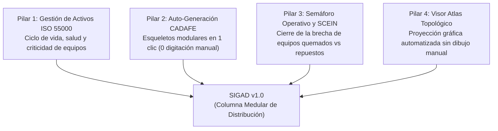

# DOCUMENTO DE ARQUITECTURA Y ESPECIFICACIÓN TÉCNICA
## SISTEMA INTEGRADO DE GESTIÓN DE ACTIVOS DE DISTRIBUCIÓN (SIGAD v1.0)
### Subestaciones (SE), Circuitos (CTO) y Equipos de Red SEN

```text
====================================================================================================
ÓRGANO EMISOR    : CORPOELEC — GERENCIA GENERAL DE PLANIFICACIÓN DE DISTRIBUCIÓN (GGPD)
CÓDIGO DOCUMENTO : NAC_2026_GGPD_SIGAD_ARQUITECTURA_GESTION_ACTIVOS_V01
AUTORES / EQUIPO : Yván M. Cipiran N. (Automatización e IA) & Consultor Senior de Sistemas de Potencia
MARCO NORMATIVO  : ISO 55000/55001 · ISO 8000-110 · ISO/IEC 27001:2022 · CADAFE NS-P-105 · IEEE 1366
ALCANCE V1.0     : Despliegue Local (Laptop / Puerto 3007) · 871 SE · 4.207 CTO · Auto-Esqueleto CADAFE
FECHA DE EMISIÓN : Octubre 2026
====================================================================================================
```

---

## 1. RESUMEN EJECUTIVO Y ANTECEDENTES

La Gerencia General de Distribución (GGD) y la Gerencia General de Planificación de Distribución (GGPD) de CORPOELEC enfrentan una pérdida crítica de observabilidad y control sobre los activos de la red eléctrica nacional. La desarticulación de los sistemas SCADA de otras unidades y la proliferación de instrumentos manuales en hojas de cálculo (Google Drive con más de 1.400 archivos y 50 pestañas por libro) han sobrecargado al personal técnico en las 24 entidades federales.

La consecuencia directa ha sido la generación de datos desfasados o ficticios, la duplicación de reportes de fallas y la falta de actualización cuando se reemplazan equipos críticos (como transformadores de potencia quemados vs. reposición en SCEIN).

**SIGAD (Sistema Integrado de Gestión de Activos de Distribución)** nace como la **columna medular** de software que institucionaliza el conocimiento de los especialistas veteranos y lo convierte en una plataforma de grado industrial accesible para los analistas de campo.

---

## 2. PILARES ESTRATÉGICOS Y FILOSOFÍA DE DISEÑO



1. **Cero Agotamiento en Campo (No más páginas en blanco):**
   El sistema no obliga al analista a escribir a mano 80 componentes por subestación. Provee un motor de **Auto-Esqueleto Modular por Bahías** basado en los estándares históricos del **Atlas CADAFE** y la norma venezolana **NS-P-105**.
2. **Ciclo de Vida y Verdad Única (Integración con SCEIN):**
   Cada componente posee un estado operativo en tiempo real (`EN SERVICIO`, `INDISPONIBLE / AVERIADO`, `EN OBSERVACIÓN`, `NO INSTALADO`). Cuando un transformador se avería o se repone, se actualiza en 1 clic y sincroniza la trazabilidad de indisponibilidad.
3. **Módulo Atlas Topológico:**
   La representación unifilar no es un dibujo estático en AutoCAD, sino una proyección visual esquemática generada automáticamente a partir del grafo de activos en la base de datos.

---

## 3. ARQUITECTURA DE DATOS: MODELO JERÁRQUICO POR BAHÍAS

El modelo descompone cada instalación eléctrica en una jerarquía estricta de 4 niveles:

```text
NIVEL 1: SUBESTACIÓN (core.mae_subestaciones - 871 SE)
  │
  ├── NIVEL 2: BAHÍAS DE PATIO (Bay Groups)
  │     ├── Bahía de Transformación AT (115 kV o 34.5 kV)
  │     ├── Bahía de Barras Colectoras MT (13.8 kV / 34.5 kV)
  │     ├── Bahías de Salida de Circuitos (CTO Alimentadores)
  │     ├── Bahía de Servicios Auxiliares (SSAA - AC/DC)
  │     └── Bahía de Infraestructura y Seguridad de Patio
  │
  ├── NIVEL 3: COMPONENTES Y EQUIPOS FÍSICOS (Equipment Assets)
  │     ├── Transformador de Potencia (TR-1, TR-2...)
  │     ├── Disyuntor / Interruptor de Potencia (D1, D2...)
  │     ├── Seccionadores de Maniobra y Tierra (S1, S2...)
  │     ├── Transformadores de Medida (TC / TP)
  │     ├── Pararrayos / Descargadores ZnO
  │     ├── Reconectadores de Línea (R)
  │     ├── Banco de Baterías 125 Vcc y Rectificador
  │     └── Malla de Puesta a Tierra y Grava de Patio
  │
  └── NIVEL 4: EVENTOS OPERATIVOS Y DIAGNÓSTICO (Lifecycle Log)
        ├── Declaración de Falla / Avería
        ├── Sustitución / Reposición (Nuevo serial / MVA)
        └── Ensayos de Aislamiento y DGA (Gases disueltos)
```

---

## 4. NOMENCLATURA INDUSTRIAL NORMALIZADA (CADAFE NS-P-105)

Todo componente generado en SIGAD adopta los códigos canónicos de patio:
* **`D` (Disyuntor / Interruptor de Potencia):** Elemento de corte bajo carga y cortocircuito.
* **`S` (Seccionador):** Aislamiento visible de seguridad para mantenimiento.
* **`TR` (Transformador de Potencia):** Unidad reductora de tensión.
* **`B` (Barras Colectoras):** Nodo distribuidor de potencia.
* **`TC / TP`:** Transformadores de medida y protección (5A / 120V).
* **`REC` (Reconectador):** Interruptor en cabecera de circuito para fallas transitorias.
* **`SSAA`:** Banco de Baterías, Cargador y Transformador de Servicios Auxiliares.

---

## 5. HOJA DE RUTA DE DESPLIEGUE (FASE LOCAL V1.0)

* **Entorno:** Local (Laptop de desarrollo / Node.js + Vite + TypeScript + React).
* **Puerto Oficial:** `3007` (reservado para SIGAD en el Repositorio Maestro).
* **Fuentes de Datos:**
  - Caché de Alta Disponibilidad local con las **871 Subestaciones** y **4.207 Circuitos** de `core`.
  - Persistencia local en navegador (`localStorage` enriquecido) y puente REST listo para InsForge PostgreSQL (Esquema `sigad`).
* **Entregable del Viernes:**
  1. Ficha 360° de la Subestación con estadísticas en vivo.
  2. Motor de Auto-Generación de Esqueleto CADAFE en 1 clic.
  3. Árbol interactivo de componentes por Bahías.
  4. Módulo de Diagnóstico con cambio de estado de transformadores.
  5. Visor Atlas Topológico (Unifilar generado por código).
